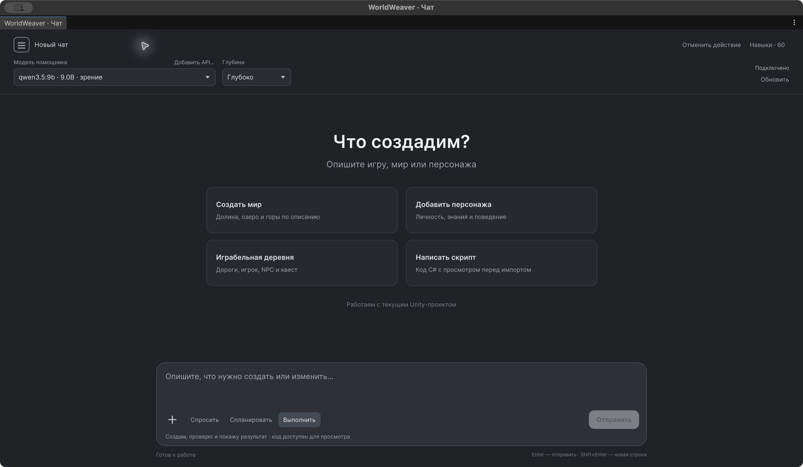
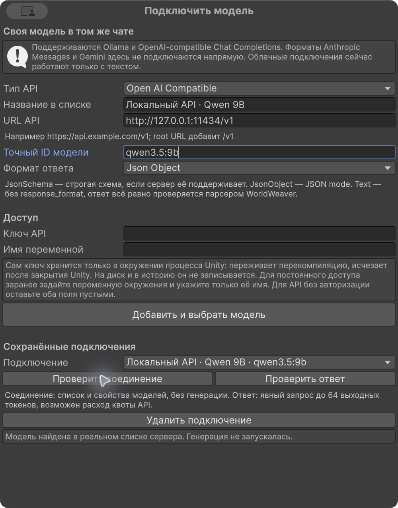
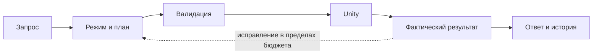

<div align="center">

# WorldWeaver

**Игровые миры, NPC и C# — в одном чате Unity.**

Опишите задачу, посмотрите план и проверьте результат в сцене.
Локальные модели через Ollama, просмотр кода и восстановление изменений.

[](Packages/com.worldweaver.toolkit/package.json)
[](WORKPLAN-1.2.md)
[](results/integration-1.2-seventh-r3-summary.json)
[](results/editor-schema-verification-1.2.json)
[](Packages/com.worldweaver.toolkit/Editor/Skills/THIRD-PARTY-NOTICES.md)

[Быстрый запуск](#быстрый-запуск) · [Возможности](#что-умеет) · [Модели](#модели) · [Документация](#документация)

</div>

> **WorldWeaver 1.2.0.** [Файлы выпуска](https://github.com/saslekawaiii/worldweaver-thesis/releases/tag/v1.2.0) · [Проверка комплекта](results/delivery-validation-1.2.json). Репозиторий приватный; результаты относятся к явно указанным версиям и условиям.



Реальный интерфейс Unity 6000.3.27f1. [Проверка размеров окна и подключения API](results/ui-centering-1.2-native-verification.json).

## Что умеет

| Мир и персонажи | Работа в редакторе |
| --- | --- |
| **Terrain и деревня.** Рельеф, дома, дороги, именованные места и NavMesh. | **Три режима.** Спросить, спланировать или выполнить изменения. |
| **Игровые NPC.** Индивидуальные знания, действия, расписание и события. | **C# с просмотром.** Новые компоненты и точечные патчи существующих файлов. |
| **Готовый игровой пример.** Игрок, ворота, доставка письма и сохранение состояния. | **Проверки и восстановление.** Compiler feedback, Unity jobs и контрольная точка запроса. |
| **Свои ресурсы.** Каталог и размещение существующих prefabs проекта. | **Контекст.** Изображения для локальной vision-модели и 60 справочных MD-навыков. |

Это инструментарий прототипирования. Художественные 3D-модели, риги, голос и PDF ingestion не реализованы; превосходство над Unity Assistant не измерялось. [Точные границы](docs/agent-architecture-and-limits.md).

## Быстрый запуск

**1. Установите пакет.** Целевая среда — Unity 6000.3; разработка ведётся в 6000.3.27f1. В Package Manager выберите **Install package from disk** и `Packages/com.worldweaver.toolkit/package.json`, либо откройте `UnityProject`.

<details>
<summary>Установка из Git по тегу 1.2.0</summary>

```text
https://github.com/saslekawaiii/worldweaver-thesis.git?path=/Packages/com.worldweaver.toolkit#v1.2.0
```

Для приватного репозитория нужен авторизованный Git; токен не вставляется в URL.

</details>

**2. Запустите Ollama и установите модели.** Локальный endpoint — `http://127.0.0.1:11434`.

```sh
ollama pull qwen3.5:9b
ollama pull embeddinggemma
```

**3. Откройте Tools → WorldWeaver → Чат.** Для создания мира выберите Qwen3.5 9B и **«Глубоко»** — этот бюджет использован в завершённом локальном разговоре. Начните с режима **Спланировать**, проверьте предложенные изменения и нажмите **Применить**.

```text
Создай деревню с пятью домами, площадью, северными воротами,
игроком и доставкой письма.
```

Затем уточняйте ту же сцену следующими репликами. В режиме **Спросить** помощник читает и объясняет; **Выполнить** применяет допустимые операции. Начальный C# и патчи требуют просмотра.

На испытанном Mac M4 с 16 ГиБ и включённым энергосбережением отдельные задания Deep заняли примерно 1,7–5,4 минуты. «Баланс» и «Быстро» уменьшают бюджет; для крупных изменений они могут завершиться раньше выполнения всех условий.

**Готовая игровая демонстрация:** Tools → WorldWeaver → **Создать играбельную деревню** → Play. Команда предлагает сохранить текущие правки, создаёт новую сцену под уникальным именем и добавляет её в Build Settings, сохраняя прежние записи. Это заранее заданный план без LLM. В игре: **WASD**, правая кнопка мыши для камеры, **E** для действия; Save/Load доступны на экране.

Готовый `WorldPlayer` требует **Input Manager (Old)** или **Both** в Active Input Handling. В проектах только с New Input System нужна интеграция соответствующего контроллера/ввода; все конфигурации ввода не испытывались.

[Снимок завершённой доставки письма и награды](docs/screenshots/1.2/village-quest-completed.jpg) — реальное прохождение в Unity Play Mode без LLM.

## Модели

| Маршрут | Назначение |
| --- | --- |
| **Ollama · Qwen3.5 9B** | Начальная локальная модель чата; требует заметной памяти и времени. |
| **Другие установленные Ollama-модели** | Выбираются в чате. Поддержка изображений проверяется отдельно. |
| **EmbeddingGemma** | Поиск знаний игровых NPC, отдельно от completion-модели. |
| **Pollinations Classic** | Необязательное бесплатное облако, зависит от внешних квот. |
| **Свой API · OpenAI-compatible / Ollama** | Добавляется в тот же чат кнопкой **Добавить API…**, без C#. |

**Свой API:** откройте **Добавить API…**, укажите тип, URL и точный ID модели, выберите один способ авторизации и нажмите **Добавить и выбрать модель**. Ключ из формы действует в текущем процессе Unity; постоянный доступ настраивается отдельно через имя внешней переменной окружения. [Пошаговая инструкция](docs/custom-api.md).

<details>
<summary>Как выглядит подключение своей модели</summary>



На снимке подключён локальный OpenAI-compatible endpoint Ollama; проверка прочитала список моделей. Это не испытание всех внешних API.

</details>

«Быстро / Баланс / Глубоко» меняет бюджет шагов, контекста и ожидания, а не размер модели. Локальный маршрут не требует покупки API. При выборе облака отобранный контекст передаётся внешнему сервису. [Настройка и пределы](Packages/com.worldweaver.toolkit/Documentation~/index.md#необязательное-облако-и-ограничения).

## Как проходит задача



Промежуточный поток текста не запускает инструменты. Модельное «готово» проверяется по доступным условиям и результатам Unity. Контрольная точка восстанавливает изменения запроса при отсутствии конфликтов; это ограниченный снимок проекта, не песочница C#.

## Документация

| Начать работу | Разобраться глубже |
| --- | --- |
| [Руководство пользователя](Packages/com.worldweaver.toolkit/Documentation~/index.md) | [Устройство и ограничения агента](docs/agent-architecture-and-limits.md) |
| [Подключить свой API](docs/custom-api.md) | [Навыки: источники и лицензии](docs/skills/README.md) |
| [Режимы, код и восстановление](Packages/com.worldweaver.toolkit/Documentation~/index.md#код-проверки-и-продолжение) | [Архитектурные решения](docs/adr) |
| [Участие и воспроизведение проверок](CONTRIBUTING.md) | [Сопоставление с Unity Assistant](docs/research/chat-agent-comparison.md) |
| [План версии 1.2](WORKPLAN-1.2.md) | [Сохранённые результаты 1.1](docs/releases-v1.1.md) |

Бейджи ведут на конкретные сохранённые протоколы, а не на CI. [397 EditMode и 9 PlayMode проверок](results/integration-1.2-seventh-r3-summary.json) прошли на снимке R3 без внешнего inference. Отдельный [разговор из семи последовательных заданий](results/chat-agent-acceptance-local-1.2-final.json) завершён 7/7 на R2 с Qwen3.5 9B / Deep; это один ограниченный сценарий, не inference на R3 и не сравнительный benchmark. Его просмотренный C# отдельно прошёл [11 проверок импорта, компиляции, attach и revert на R3](results/chat-code-acceptance-local-1.2.json).

На R3 отдельно [измерено вращение просмотренного исходника](results/rotation-runtime-acceptance-final-1.2.json): около 60° за 2 с, неподвижный контроль отклонён. Один [image-only ответ](results/vision-agent-acceptance-1.2.json) верно связал стороны и цвета, но назвал куб параллелепипедом: строгий критерий формы не пройден; [независимый разбор](results/vision-agent-semantic-review-1.2.json) сохраняет этот неуспех.

Base schema относится к одной матрице из 33 случаев для полной и decoder-схемы. [Пакет R3 установлен в новый consumer-проект](results/clean-install-1.2.0.json): exit 0, ошибок компиляции нет. Общая надёжность LLM и экономия времени разработчика по этим данным не установлены; исторические показатели не переносятся на новый код. [Итоговая проверка документов и продукта](results/delivery-validation-1.2.json); исходный commit, ZIP и Git bundle фиксируются в [составе поставки](https://github.com/saslekawaiii/worldweaver-thesis/releases/download/v1.2.0/%D0%A1%D0%BE%D1%81%D1%82%D0%B0%D0%B2_%D0%BF%D0%BE%D1%81%D1%82%D0%B0%D0%B2%D0%BA%D0%B8.json).

## О проекте и лицензиях

WorldWeaver — практическая часть ВКР **«Разработка интеллектуального инструментария для автоматизированного создания динамических игровых миров»**. [Исходники документов и сборка](thesis/README.md).

Материалы версии 1.2: ВКР — 101 страница, 80 до приложений; ТЗ — 14 страниц; презентация — 12 слайдов; доклад — 1077 слов, ориентир 8 мин 40 с. [Начать с файлов поставки](deliverables/НАЧНИТЕ_ЗДЕСЬ.md).

Общая лицензия авторского кода пока не назначена. MIT notices относятся к адаптированной библиотеке MD-навыков; [происхождение и условия](docs/LICENSING.md). Назначение лицензии всему проекту выполняется автором отдельно.
