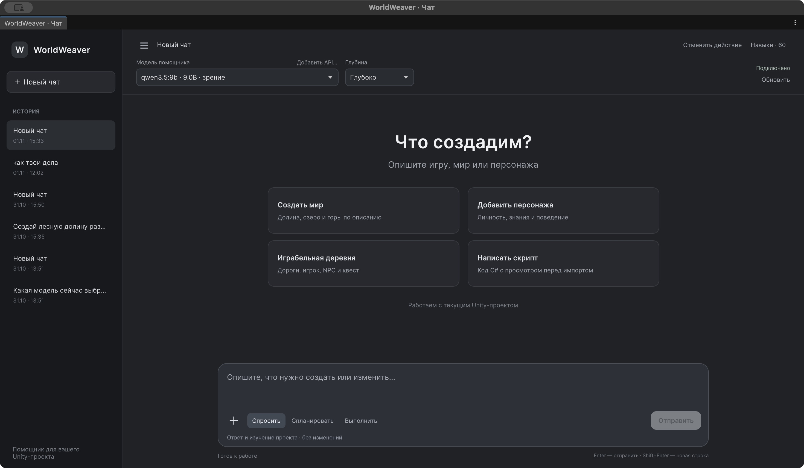
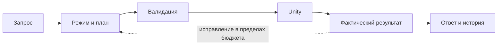

<div align="center">

# WorldWeaver

**Игровые миры, NPC и C# — в одном чате Unity.**

Опишите задачу, посмотрите план и проверьте результат в сцене.
Автоматический список локальных моделей, текстуры, свободные разговоры NPC,
просмотр C# и восстановление изменений.

[](Packages/com.worldweaver.toolkit/package.json)
[](docs/general-agent-workflow.md)
[](docs/character-workflow-fix.md)
[](results/editor-schema-verification-1.2.json)
[](Packages/com.worldweaver.toolkit/Editor/Skills/THIRD-PARTY-NOTICES.md)

[Быстрый запуск](#быстрый-запуск) · [Возможности](#что-умеет) · [Модели](#модели) · [Документация](#документация)

</div>

> **Развитие общего агента 1.4.0** — 80 MD-навыков с привязкой к реальным командам, поиск инструментов по ходу задачи, этапы составного запроса, собственные меши, кисти и повышение разрешения Terrain, пещеры, физика и создание/настройка UGUI. [Устройство, проверка и ограничения](docs/general-agent-workflow.md).

> **Исправление 1.3.1** — настоящий анимированный герой из встроенного ассета, короткий план вместо большого JSON с C#, правдивые состояния ошибок и поддержка обоих Unity Input backend. Точный запрос проверен на Qwen 9B и бесплатном GPT-OSS; отдельно проверен URP-проект с программной клавиатурой Input System. [Исправление и протоколы](docs/character-workflow-fix.md) · [Выпуск](https://github.com/saslekawaiii/worldweaver-thesis/releases/tag/v1.3.1).



Настоящее окно **1.3 R11** в Unity 6000.3.27f1. История остаётся сбоку; приветствие, карточки и поле сообщения выровнены в одной колонке. [Нативное восстановление списка Ollama](results/ollama-native-restart-1.3.json) проверено отдельно от ответа модели.

## Что умеет

| Мир и персонажи | Работа в редакторе |
| --- | --- |
| **Terrain и деревня.** Рельеф, дома, дороги, именованные места и NavMesh. | **Три режима.** Спросить, спланировать или выполнить изменения. |
| **Текстурные поверхности.** 13 встроенных CC0-материалов и поиск PBR-наборов Poly Haven. | **Модели без ручного списка.** Запущенная Ollama и новые установленные модели обнаруживаются автоматически. |
| **Свободные разговоры NPC.** Собственная реплика игрока, история, включение ИИ у каждого персонажа. | **C# для новых механик.** Агент получает инструменты подготовки компонентов без обязательного слова «скрипт» в запросе. |
| **Общение между NPC.** Поочерёдные ответы модели, личности, цели и ограниченная память. | **Просмотр перед импортом.** После просмотра Unity компилирует применённый компонент; игровое поведение проверяется отдельно. |
| **Анимированный главный герой.** Две встроенные модели Kenney CC0, кости, Idle/Walk/Sprint, Jump/Fall, камера и управление; оба Unity Input backend. | **Достоверный статус.** Усечённый план не исполняется, ошибка и неприменённый план не выглядят успешными. |
| **Игровой пример.** Игрок, ворота, доставка письма и сохранения; каталог существующих prefabs проекта. | **Проверки и восстановление.** Unity jobs, контрольная точка запроса, изображения и 80 MD-навыков с рецептами и ссылками на команды. |

Срез **R11** прошёл 601 проверку редактора и 21 проверку Play Mode. Настоящий запрос материала через чат R11 прошёл [26 условий](results/material-chat-acceptance-1.3-r11.json) и [независимый смысловой разбор](results/material-chat-semantic-review-1.3-r11.json); один просмотренный компонент прошёл [нативную проверку F](results/beacon-native-acceptance-1.3-r11.json). Эти отдельные сценарии не устанавливают успешность любого запроса. Это инструментарий прототипирования. [Подробные результаты и ограничения](docs/1.3-status.md) · [Устройство агента](docs/agent-architecture-and-limits.md).

## Быстрый запуск

**1. Установите пакет.** Целевая среда — Unity 6000.3; разработка ведётся в 6000.3.27f1. В Package Manager выберите **Install package from disk** и `Packages/com.worldweaver.toolkit/package.json`, либо откройте `UnityProject`.

Установка 1.4.0 из Git:

```text
https://github.com/saslekawaiii/worldweaver-thesis.git?path=/Packages/com.worldweaver.toolkit#v1.4.0
```

При установке из Git токен не вставляется в URL. Готовый TGZ и протоколы находятся в [выпуске](https://github.com/saslekawaiii/worldweaver-thesis/releases/tag/v1.4.0).

**2. Запустите приложение Ollama и установите разговорную модель.** Локальный endpoint — `http://127.0.0.1:11434`. Если приложение Ollama не запущено, выполните `ollama serve` в отдельном терминале.

```sh
ollama pull qwen3.5:9b
```

В версии 1.3 установленные модели появятся в чате автоматически: проверка выполняется примерно через 10 секунд, при недоступном сервере — через 30 секунд. Нажатие **Обновить** запускает проверку сразу. Модель не обязана заранее находиться в памяти. [Запуск, скачивание и состояния моделей](docs/local-models.md).

**3. Откройте Tools → WorldWeaver → Чат.** Выберите установленную модель и бюджет. Начните с режима **Спланировать**, проверьте предложенные изменения и нажмите **Применить**. Qwen3.5 9B / **«Глубоко»** использовалась в завершённом запросе материала R11; его результаты приведены отдельно от программных тестов.

```text
Создай деревню с пятью домами, площадью, северными воротами,
игроком и доставкой письма.
```

Затем уточняйте ту же сцену следующими репликами. В режиме **Спросить** помощник читает и объясняет; **Выполнить** применяет допустимые операции. Начальный C# и патчи требуют просмотра.

Один проверенный запрос материала R11 занял **8 мин 54 с**. «Глубоко» допускает до 6 шагов и 15 минут, «Баланс» — до 3 шагов и 4 минут, «Быстро» — до 1 шага и 2 минут. Для составных конструктивных задач 1.4.0 расширяет цикл до 6/8/16 шагов и 5/10/15 минут соответственно. Поиск инструментов и чтение навыка также открывают дополнительные шаги в текущем бюджете. Это пределы работы, а не обещание скорости; модель и квоты API могут помешать завершить запрос.

**4. Добавьте поверхности и поведение.** Например: «Найди на Poly Haven выветренное дерево и примени к двери»; «Используй встроенную брусчатку для площади без интернета»; «Сделай куб, который переключается между синим и янтарным по нажатию F». Для новых механик включён параметр **«Создавать C# для новых игровых механик»**. Предложенный C# остаётся черновиком до вашего ревью; компиляция отдельно отрабатывает после применения. [Материалы](docs/material-library.md) · [NPC и свободный разговор](docs/npc-ai.md).

**Готовая игровая демонстрация:** Tools → WorldWeaver → **Создать играбельную деревню** → Play. Команда предлагает сохранить текущие правки, создаёт новую сцену под уникальным именем и добавляет её в Build Settings, сохраняя прежние записи. Это заранее заданный план без LLM. Новые NPC используют `qwen3.5:9b`; установите её либо явно назначьте свой профиль. Ответы локальной модели могут занимать минуты. В игре: **WASD**, правая кнопка мыши для камеры, **E** для действия; Save/Load доступны на экране.

`WorldPlayer` поддерживает **Input Manager (Old)**, **Both** и **New Input System**. Для нового backend проверен реальный цикл обновления с программной клавиатурой Input System в изолированном URP-проекте; это отдельно от проверки физической клавиатуры в нативном Game View.

[Снимок завершённой доставки письма и награды](docs/screenshots/1.2/village-quest-completed.jpg) — реальное прохождение в Unity Play Mode без LLM.

## Модели

| Маршрут | Назначение |
| --- | --- |
| **Ollama · Qwen3.5 9B** | Начальная локальная модель чата; требует заметной памяти и времени. |
| **Другие установленные Ollama-модели** | Появляются автоматически; completion/vision читаются из `/api/show`, «в памяти» — из `/api/ps`. |
| **EmbeddingGemma** | Поиск знаний игровых NPC, отдельно от completion-модели. |
| **Pollinations Classic** | Необязательное бесплатное облако, зависит от внешних квот. |
| **Свой API · OpenAI-compatible / Ollama** | Добавляется в тот же чат кнопкой **Добавить API…**, без C#. |

**Свой API:** откройте **Добавить API…**, укажите тип, URL и точный ID модели, выберите один способ авторизации и нажмите **Добавить и выбрать модель → Проверить соединение**. Поддерживаются OpenAI-compatible Chat Completions и Ollama; нативные Anthropic Messages/Gemini требуют адаптера. Ключ из формы действует в текущем процессе Unity; постоянный доступ настраивается отдельно через имя внешней переменной окружения. [Пошаговая инструкция](docs/custom-api.md).

Для обычной локальной Ollama форму API заполнять не нужно. Embedding-модель не предлагается как разговорная. При необходимости semantic retrieval для знаний NPC отдельно установите `ollama pull embeddinggemma`; простые разговоры и встроенные поверхности не требуют этого скачивания.

<details>
<summary>Как выглядит подключение своей модели</summary>


На снимке подключён локальный OpenAI-compatible endpoint Ollama; проверка прочитала список моделей. Это не испытание всех внешних API.

</details>

«Быстро / Баланс / Глубоко» меняет бюджет шагов, контекста и ожидания, а не размер модели. Локальный маршрут не требует покупки API. При выборе облака отобранный контекст передаётся внешнему сервису. [Настройка и пределы](Packages/com.worldweaver.toolkit/Documentation~/index.md#необязательное-облако-и-ограничения).

NPC получают профиль модели отдельно. В чате можно попросить **«Включи ИИ у выбранного NPC и используй выбранную модель»**; смена модели самого чата автоматически не переназначает существующих персонажей. В игре **E** открывает свободный ввод, Enter отправляет реплику, Esc закрывает разговор. Общение NPC включается отдельно; запросы ограничены общей очередью и бюджетом. Квестовые предметы и награды остаются проверяемыми действиями игры.

## Как проходит задача



Промежуточный поток текста не запускает инструменты. Модельное «готово» проверяется по доступным условиям и результатам Unity. Контрольная точка восстанавливает изменения запроса при отсутствии конфликтов; это ограниченный снимок проекта, не песочница C#.

## Документация

| Начать работу | Разобраться глубже |
| --- | --- |
| [Руководство пользователя](Packages/com.worldweaver.toolkit/Documentation~/index.md) | [Устройство и ограничения агента](docs/agent-architecture-and-limits.md) |
| [Подключить свой API](docs/custom-api.md) | [Навыки: источники и лицензии](docs/skills/README.md) |
| [Автоматическое обнаружение Ollama](docs/local-models.md) | [Статус и границы проверок 1.3](docs/1.3-status.md) |
| [Материалы и текстуры](docs/material-library.md) | [Свободный разговор и общение NPC](docs/npc-ai.md) |
| [Режимы, код и восстановление](Packages/com.worldweaver.toolkit/Documentation~/index.md#код-проверки-и-продолжение) | [Архитектурные решения](docs/adr) |
| [Участие и воспроизведение проверок](CONTRIBUTING.md) | [Сопоставление с Unity Assistant](docs/research/chat-agent-comparison.md) |
| [План версии 1.3](WORKPLAN-1.3.md) | [Техническое дополнение к ВКР 1.3](docs/thesis-1.3-supplement.md) |

Бейджи ведут на конкретные сохранённые протоколы, а не на CI. Программный срез R11 и результаты отдельных модельных разговоров разделены в [статусе версии](docs/1.3-status.md).

<details>
<summary>Свидетельства предыдущей поставки 1.2</summary>

Следующие показатели относятся к **версии 1.2**.

[397 EditMode и 9 PlayMode проверок](results/integration-1.2-seventh-r3-summary.json) прошли на снимке R3 без внешнего inference. Отдельный [разговор из семи последовательных заданий](results/chat-agent-acceptance-local-1.2-final.json) завершён 7/7 на R2 с Qwen3.5 9B / Deep; это один ограниченный сценарий, не inference на R3 и не сравнительный benchmark. Его просмотренный C# отдельно прошёл [11 проверок импорта, компиляции, attach и revert на R3](results/chat-code-acceptance-local-1.2.json).

На R3 отдельно [измерено вращение просмотренного исходника](results/rotation-runtime-acceptance-final-1.2.json): около 60° за 2 с, неподвижный контроль отклонён. Один [image-only ответ](results/vision-agent-acceptance-1.2.json) верно связал стороны и цвета, но назвал куб параллелепипедом: строгий критерий формы не пройден; [независимый разбор](results/vision-agent-semantic-review-1.2.json) сохраняет этот неуспех.

Base schema относится к одной матрице из 33 случаев для полной и decoder-схемы. [Пакет R3 установлен в новый consumer-проект](results/clean-install-1.2.0.json): exit 0, ошибок компиляции нет. Общая надёжность LLM и экономия времени разработчика по этим данным не установлены; исторические показатели не переносятся на новый код. [Итоговая проверка документов и продукта](results/delivery-validation-1.2.json); исходный commit, ZIP и Git bundle фиксируются в [составе поставки](https://github.com/saslekawaiii/worldweaver-thesis/releases/download/v1.2.1/WorldWeaver-delivery-manifest.json).

</details>

## О проекте и лицензиях

WorldWeaver — практическая часть ВКР **«Разработка интеллектуального инструментария для автоматизированного создания динамических игровых миров»**. [Исходники документов и сборка](thesis/README.md).

Материалы версии 1.2: ВКР — 101 страница, 80 до приложений; ТЗ — 14 страниц; презентация — 12 слайдов; доклад — 1077 слов, ориентир 8 мин 40 с. [Начать с файлов поставки](deliverables/НАЧНИТЕ_ЗДЕСЬ.md).

Общая лицензия авторского кода пока не назначена. MIT notices относятся к адаптированной библиотеке MD-навыков; [происхождение и условия](docs/LICENSING.md). Встроенные процедурные карты и загружаемые texture-assets Poly Haven используют CC0; условия API и кредит источника описаны в [библиотеке материалов](docs/material-library.md). Назначение лицензии всему проекту выполняется автором отдельно.
