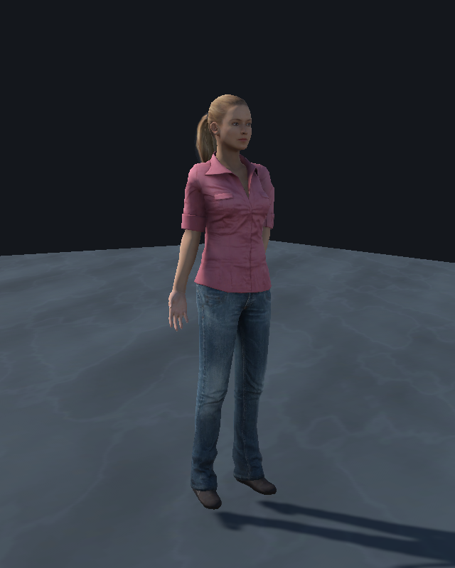
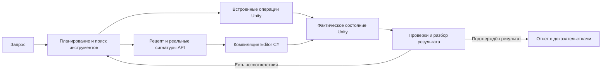

<div align="center">

# WorldWeaver

**Unity-разработка через чат: от запроса до проверяемых изменений сцены.**

[](Packages/com.worldweaver.toolkit/package.json)
[](https://github.com/saslekawaiii/worldweaver-thesis/releases/tag/v1.6.0)
[](docs/unity-recipes.md)
[](Packages/com.worldweaver.toolkit/Editor/RecipeLibrary/catalog.json)
[](deliverables/WorldWeaver-1.6.0-validation.json)

[Установка](#установка) · [Модели](#модели) · [Проверки](#проверки) · [Документация](#документация)

</div>

WorldWeaver — исследовательский Unity-пакет с агентом в редакторе. Помощник читает проект, обнаруживает инструменты, применяет изменения и получает фактические результаты Unity. Для операций за пределами встроенных команд он может найти API-рецепт, проверить сигнатуры и скомпилировать собственный Editor C#.

**1.6.0 — предварительный выпуск.** Переработаны завершение и восстановление агента, чтение старых результатов, промежуточная проверка цели и обработка относительных правок. Добавлены поиск, загрузка и замена реальных моделей: 115 персонажей Microsoft Rocketbox под MIT, плюс ассеты самого проекта. [Изменения общего цикла и границы проверки](docs/agent-loop-1.6.md).


Снимок интерфейса относится к версии 1.3 R11. В [нативном осмотре установленной версии 1.6.0](results/native-ui-1.6.0.json) подтверждены центровка широкого окна, новый чат, 114 навыков и подключённая модель. Отправка запроса в этой проверке интерфейса не выполнялась; живые запросы запускались отдельно через контроллер чата.



Реальная модель после замены внешности агентом. Проверка ввода подтверждает движение контроллера и костей; при отсутствии совместимых клипов используется процедурная локомоция.

## Как выполняется запрос



В режиме «Глубоко» выполняется отдельный модельный разбор всего запроса по свежим измерениям без прежнего ответа исполнителя. После нескольких изменений промежуточная проверка может остановить дальнейшее редактирование, если цель уже достигнута. Рецепты и результаты инструментов передаются с подходящими лимитами контекста. [Подробный процесс](docs/unity-recipes.md).

## Возможности

| Область | Возможности |
| --- | --- |
| Агент | Чат с историей, режимы «Спросить», «Спланировать», «Выполнить», выбор модели и бюджета; обнаружение новых инструментов по ходу задачи. |
| Расширение через C# | Поиск 466 API-рецептов, отражение реальных типов проекта, компиляция и выполнение Editor C#, диагностика для следующего шага агента. Игровые MonoBehaviour проходят сохранение исходника и обычную компиляцию Unity. |
| Мир | Terrain, кратеры, повышение разрешения сетки, пещеры с коллайдерами и отверстиями, сохранение связанных объектов при изменении размеров мира, звёздное небо и свет. |
| Объекты и физика | Собственные меши, prefabs проекта, компоненты, материалы, Rigidbody, коллайдеры, физические материалы, UI и привязка действий кнопок. |
| Ресурсы | 13 встроенных CC0-материалов, поиск и импорт PBR-наборов Poly Haven, каталог ассетов проекта. Встроенные модели Kenney CC0; поиск и загрузка 115 моделей людей Rocketbox MIT, замена облика и создание героя из выбранного FBX/prefab. |
| Персонажи | Анимированный управляемый герой, камера, старый и новый Input System, игровые системы кислорода и восстановления на базе. |
| NPC | Свободный ввод реплики игрока, отдельные профили моделей, личность, цели и память; ограниченный обмен репликами между NPC, маршруты по NavMesh. |
| Контроль результата | Чтение настоящего состояния, буквальные условия, диагностика компиляции, Unity jobs, контрольные точки и журнал действий. Неудачный ответ модели не объявляется выполненной задачей. |

## Установка

Целевая версия — **Unity 6000.3**; испытания выполняются на **6000.3.27f1**, в том числе в URP 17.3 с новым Input System.

В Package Manager выберите **Install package from Git URL**:

```text
https://github.com/saslekawaiii/worldweaver-thesis.git?path=/Packages/com.worldweaver.toolkit#v1.6.0
```

Либо установите TGZ из [выпуска 1.6.0](https://github.com/saslekawaiii/worldweaver-thesis/releases/tag/v1.6.0) через **Install package from tarball**. Для локальной разработки используйте `Packages/com.worldweaver.toolkit/package.json` или проект `UnityProject`.

Откройте **Tools → WorldWeaver → Чат**, выберите модель и напишите задачу. Например:

```text
Построй мост длиной 8 метров и шириной 3 метра из собственного меша с коллайдером.
```

```text
Создай экранное меню с панелью и кнопкой, которая переключает её видимость.
```

```text
Найди подходящий Unity API-рецепт и создай физический объект с шарниром.
Проверь компоненты и размеры по фактическому состоянию.
```

Для новых операций через API включите в настройках чата **«Автономный C# с доступом Unity Editor»**. Это доверенный код с полномочиями редактора, не песочница. Он выполняется синхронно; Undo восстанавливает зарегистрированные изменения сцены, но не произвольные записи файлов. Для игровых скриптов доступен отдельный просмотр исходника перед импортом. [Рабочий процесс и ограничения](docs/unity-recipes.md).

## Модели

**Локально:** запустите Ollama. Установленные разговорные модели появляются в списке автоматически; кнопка «Обновить» проверяет подключение сразу. [Запуск и диагностика](docs/local-models.md).

**Другой API:** в окне подключений задайте протокол, endpoint, точный ID модели и при необходимости ключ. Поддерживаются Ollama и OpenAI-compatible. Ключи сохраняются локально и не должны попадать в Git. [Как добавить новый API](docs/custom-api.md).

Нативный режим требует поддержки вызова функций выбранной моделью и провайдером. В настройках есть прежний JSON-режим совместимости. Бюджеты нативного режима: до 16/32/64 шагов и 15/30/60 минут; это пределы, а не обещание скорости. Локальные модели могут работать значительно медленнее облачных и ошибаться чаще. Доступность бесплатного облака зависит от условий и квот провайдера.

## Проверки

[Протокол выпуска 1.6.0](deliverables/WorldWeaver-1.6.0-validation.json) содержит версии исходников, хеши архива, результаты Unity Test Runner и живых прогонов. [Пояснения к проверкам](deliverables/WorldWeaver-1.6.0-notes.md) разделяют программные тесты, запросы к настоящей модели и испытание движения в Play Mode.

В новом прогоне выполнены восемь запросов через настоящую модель: герой и его замена, физический балансир, пандус из собственного меша, чтение каталога, мир и его изменение, новый герой из ранее не скачанной модели. Проверки прежних выпусков по UI, рельефу, C#, NPC и исходной последовательности «герой → Луна» сохранены отдельно. Проверочный код не подставляет планы модели и не достраивает сцену после неудачи. Неудачные прогоны сохраняются.

Количество навыков не гарантирует выполнение любого запроса. Компиляция не доказывает игровое поведение, а успешные отдельные сценарии не доказывают полную замену разработчика.

```sh
python3 scripts/import_agent_skills.py
python3 scripts/import_model_catalog.py
python3 scripts/check_repository.py
```

Команды офлайн проверяют исходники навыков, рецептов, каталога моделей, лицензий и целостность репозитория. Unity-тесты находятся в `Packages/com.worldweaver.toolkit/Tests`.

## Документация

- [Общий цикл 1.6, модели и восстановление](docs/agent-loop-1.6.md)
- [Навыки, API-рецепты и расширение агента](docs/unity-recipes.md)
- [Исследование Unity-агентов и источники заимствования](docs/research/unity-agent-architecture.md)
- [Подключение моделей и нового API](docs/custom-api.md)
- [Локальная Ollama](docs/local-models.md)
- [Материалы и лицензии ассетов](docs/material-library.md)
- [NPC и свободный разговор](docs/npc-ai.md)
- [Составной запрос и цикл проверки](docs/general-agent-workflow.md)
- [Архитектура и пределы агента](docs/agent-architecture-and-limits.md)
- [История 1.4.0](deliverables/WorldWeaver-1.4.0-notes.md) · [История 1.3](docs/1.3-status.md)

Текст ВКР и материалы защиты находятся в `deliverables`; их исторические утверждения нужно сопоставлять с версией программного пакета и протоколом соответствующего выпуска.
