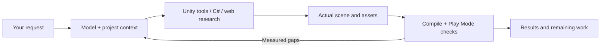

<p align="center">
  
</p>

<p align="center">
  <a href="https://github.com/saslekawaiii/scenepilot-unity/releases"></a>
  <a href="https://unity.com/releases/editor/whats-new/6000.3.27"></a>
  <a href="https://ollama.com"></a>
  <a href="https://github.com/saslekawaiii/scenepilot-unity/actions/workflows/repository-checks.yml"></a>
</p>

<p align="center"><b>English</b> · <a href="README.ru.md">Русский</a><br />
<a href="#quickstart">Quickstart</a> · <a href="#what-it-does">Features</a> · <a href="docs/validation/1.8.1/README.md">Validation</a> · <a href="#documentation">Docs</a> · <a href="https://github.com/saslekawaiii/scenepilot-unity/issues">Issues</a></p>

**ScenePilot turns natural-language requests into editable Unity scenes, assets and C# code, with feedback from the actual Editor and Play Mode.** Bring a local Ollama model or connect an OpenAI-compatible API. The agent can inspect the project, discover tools, apply changes, compile scripts and check the resulting behavior.

> **Preview:** capability and speed depend on the model, project and task. A compiled script or a successful tool call is only part of the evidence for completion.

## Quickstart

**Requirements:** Unity 6000.3; validated on **6000.3.27f1**, including URP and Input System.

**1. Install the package.** In Unity Package Manager, choose **Install package from Git URL**:

```text
https://github.com/saslekawaiii/scenepilot-unity.git?path=/Packages/com.worldweaver.toolkit#v1.8.1
```

A UPM tarball is also available under [Releases](https://github.com/saslekawaiii/scenepilot-unity/releases). Existing Git/TGZ installations need an explicit package update; a GitHub push does not update them automatically.

**2. Connect a model.** Start Ollama; installed conversational models appear in the model list. To use another service, add its base URL, exact model ID and optional API key in the connection form. Provider accounts, model downloads and inference credits are separate from this package. [Model setup →](docs/local-models.md) · [Custom API →](docs/custom-api.md)

**3. Open `Tools → ScenePilot → Chat`.** The current chat UI is in Russian: choose **Спросить** (Ask), **Спланировать** (Plan) or **Выполнить** (Execute). Describe the desired result, then inspect the operation results and verification evidence. Complex tasks benefit from the deeper reasoning budget.

For operations requiring generated Editor C# or autonomous script import, enable the corresponding project permissions. This code runs with Unity Editor access; use it with trusted projects and review generated source.

<details>
<summary>Compatibility with existing installations</summary>

The package ID remains `com.worldweaver.toolkit`; C# namespaces, generated asset paths and saved conversation locations retain their previous names. Existing scenes keep their script references. The previous `Tools → WorldWeaver → Чат` menu also remains available.

</details>

## What it does

| Capability | In the Editor |
| --- | --- |
| **Scene authoring** | Terrain, meshes, objects, materials, lights, colliders and references in the current project. |
| **C# workflow** | Inspect actual Unity APIs, generate source, compile, attach components and continue after domain reload. |
| **Asset research** | Search and read sources through a real `smolagents` tool loop; acquire supported models, materials and heightmaps with provenance. |
| **Behavior checks** | Bounded Play Mode probes with measured assertions and virtual keyboard/mouse input; observations up to two minutes. |
| **Task recovery** | Persistent task state, conflicting-edit detection, shared checkpoint storage and bounded recovery from invalid or repetitive model steps. |
| **Rendering diagnostics** | Active pipeline, material/shader compatibility and observed shader alternatives; read-only capture cleanup retains strict checkpoint comparisons. |
| **Game systems** | Player/camera tools, NPC profiles and memory, free-form dialogue, navigation and runtime actions. |

The reference library includes **114 MD skills** and **466 Unity API recipes**. They help the model find useful APIs; task success is measured separately.

## How it works



The original request stays separate from the model's tentative plan. Identical reads of unchanged state and repeated plans do not count as implementation progress. Failed behavioral evidence remains current until the implementation changes and a fresh check is performed.

## Measured validation

**The 1.8.1 preview completed validation on the frozen RC20 package**, using Unity 6000.3.27f1. The [versioned report](docs/validation/1.8.1/README.md) records the exact package hash and separates software checks, actual model requests, saved-artifact checks and visual observations.

| Check | Passed | Failed | Skipped |
| --- | ---: | ---: | ---: |
| Editor | 958 | 0 | 7 |
| Play Mode | 27 | 0 | 2 |
| Python tooling | 16 | 0 | 0 |
| Runtime-probe expected outcomes | 11 | 0 | 0 |
| Focused URP run and saved-artifact checks | 44 | 0 | 0 |

The seven Editor skips are URP-only cases; all seven passed in the separate URP run. The two Play Mode skips require external provider configuration and are not counted as passes. These suite totals overlap and are not a count of successful user tasks.

A fresh RC20 web-reference request completed in three model calls, opened two official Unity pages and left all 287 observed project files and the scene digest unchanged. The saved **RC17 mesh-repair continuation** and **RC3 door/counter artifacts** passed independent RC20 checks, including physical/input behavior and actual mesh rendering. Their original model-run versions remain explicit; they are not presented as fresh RC20 scene generation.

This version adds proactive geometry, UI input-routing and render-pipeline diagnostics, with recovery guided by measured gaps. Read-only captures restore known temporary pipeline additions while preserving the checkpoint's manual-edit guard. Creating geometry or passing a physics probe does not establish that the material renders correctly.

The hollow-mesh collision failure and interrupted task belong to **1.8.0** and remain in its [historical report](docs/validation/1.8.0/README.md#unseen-rc23-case-that-still-fails). Earlier warehouse, UI, relative-edit, lift and physics examples retain their original candidate versions there; they are not presented as fresh 1.8.1 successes.

These checks cover specific requests. They do not establish a general task-success rate, artistic quality or replacement of a developer.

## Documentation

- [Agent architecture and verification](docs/architecture.md)
- [Connecting local models](docs/local-models.md)
- [Adding another API](docs/custom-api.md)
- [Web research agent](docs/web-agent.md)
- [Unity skills and API recipes](docs/unity-recipes.md)
- [Materials and asset sources](docs/material-library.md)
- [NPCs and dialogue](docs/npc-ai.md)
- [Updating an installed package](docs/updating.md)
- [Licensing and third-party credits](docs/LICENSING.md)

## Development

[Contributing](CONTRIBUTING.md) · [Roadmap](ROADMAP.md) · [Report a bug](https://github.com/saslekawaiii/scenepilot-unity/issues/new/choose)

Keep credentials, local history, generated test projects and Unity caches out of commits. Third-party components retain their respective licenses; the original project code currently has no project-wide reuse license assigned. See [licensing details](docs/LICENSING.md).
