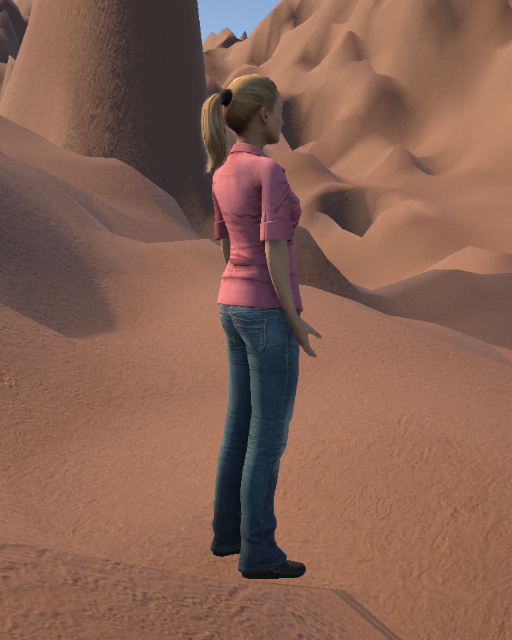
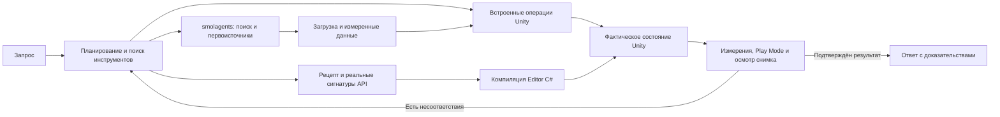

<div align="center">

# WorldWeaver

**Unity-разработка через чат: от запроса до проверяемых изменений сцены.**

[](Packages/com.worldweaver.toolkit/package.json)
[](https://github.com/saslekawaiii/worldweaver-thesis/releases/tag/v1.7.0)
[](docs/unity-recipes.md)
[](Packages/com.worldweaver.toolkit/Editor/RecipeLibrary/catalog.json)
[](deliverables/WorldWeaver-1.7.0-validation.json)

[Установка](#установка) · [Модели](#модели) · [Проверки](#проверки) · [Документация](#документация)

</div>

WorldWeaver — исследовательский Unity-пакет с агентом в редакторе. Помощник читает проект, обнаруживает инструменты, применяет изменения и получает фактические результаты Unity. Для операций за пределами встроенных команд он может найти API-рецепт, проверить сигнатуры и скомпилировать собственный Editor C#.

**1.7.0 — предварительный выпуск.** Подключён настоящий открытый интернет-исследователь `smolagents`, добавлены загрузка измеренных карт высот с происхождением и SHA-256, проверки мыши и позы в Play Mode, осмотр снимков локальной моделью зрения. Исправлены порядок инструкций модели, память нативных вызовов, пагинация сцены и получение результатов после перезагрузки Unity. [Общий цикл](docs/agent-loop-1.7.md) · [Интернет-агент и установка](docs/web-agent.md).


Снимок интерфейса относится к версии 1.3 R11. В [нативном осмотре установленной версии 1.6.0](results/native-ui-1.6.0.json) подтверждены центровка широкого окна, новый чат, 114 навыков и подключённая модель. Отправка запроса в этой проверке интерфейса не выполнялась; живые запросы запускались отдельно через контроллер чата.



Диагностический кадр сохранённого результата агента: импортированная модель Rocketbox на Terrain с высотами MOLA. Проверка ввода подтверждает мышь, WASD и движение костей без изменения исходников; при отсутствии совместимых клипов используется процедурная локомоция. Это проверка работоспособности, не образец окончательного художественного качества.

## Как выполняется запрос



В режиме «Глубоко» выполняется отдельный модельный разбор всего запроса по свежим измерениям без прежнего ответа исполнителя. После нескольких изменений промежуточная проверка может остановить дальнейшее редактирование, если цель уже достигнута. Рецепты и результаты инструментов передаются с подходящими лимитами контекста. [Подробный процесс](docs/unity-recipes.md).

## Возможности

| Область | Возможности |
| --- | --- |
| Агент | Чат с историей, режимы «Спросить», «Спланировать», «Выполнить», выбор модели и бюджета; обнаружение новых инструментов по ходу задачи. |
| Расширение через C# | Поиск 466 API-рецептов, отражение реальных типов проекта, компиляция и выполнение Editor C#, диагностика для следующего шага агента. Игровые MonoBehaviour проходят сохранение исходника и обычную компиляцию Unity. |
| Мир | Terrain, кратеры, повышение разрешения сетки, пещеры с коллайдерами и отверстиями, сохранение связанных объектов при изменении размеров мира, звёздное небо и свет. |
| Объекты и физика | Собственные меши, prefabs проекта, компоненты, материалы, Rigidbody, коллайдеры, физические материалы, UI и привязка действий кнопок. |
| Интернет | Открытый `smolagents.ToolCallingAgent`: поиск через DDGS, чтение первоисточников, ограниченная загрузка и происхождение файлов. Настоящие grayscale/raw16/PDS3 карты высот с проверкой измерений. |
| Ресурсы | 13 встроенных CC0-материалов, поиск и импорт PBR-наборов Poly Haven, каталог ассетов проекта. Встроенные модели Kenney CC0; поиск и загрузка 115 моделей людей Rocketbox MIT, замена облика и создание героя из выбранного FBX/prefab. |
| Персонажи | Анимированный управляемый герой, камера, старый и новый Input System, игровые системы кислорода и восстановления на базе. |
| NPC | Свободный ввод реплики игрока, отдельные профили моделей, личность, цели и память; ограниченный обмен репликами между NPC, маршруты по NavMesh. |
| Контроль результата | Чтение настоящего состояния, буквальные условия, диагностика компиляции, Unity jobs, контрольные точки и журнал действий. Неудачный ответ модели не объявляется выполненной задачей. |

## Установка

Целевая версия — **Unity 6000.3**; испытания выполняются на **6000.3.27f1**, в том числе в URP 17.3 с новым Input System.

В Package Manager выберите **Install package from Git URL**:

```text
https://github.com/saslekawaiii/worldweaver-thesis.git?path=/Packages/com.worldweaver.toolkit#v1.7.0
```

Либо установите TGZ из [выпуска 1.7.0](https://github.com/saslekawaiii/worldweaver-thesis/releases/tag/v1.7.0) через **Install package from tarball**. Для локальной разработки используйте `Packages/com.worldweaver.toolkit/package.json` или проект `UnityProject`.

Уже установленный TGZ или Git-пакет сам не обновляется вслед за GitHub. [Как обновить установленный аддон](docs/updating.md).

Откройте **Tools → WorldWeaver → Чат**, выберите модель и напишите задачу. Например:

```text
Построй мост длиной 8 метров и шириной 3 метра из собственного меша с коллайдером.
```

```text
Создай экранное меню с панелью и кнопкой, которая переключает её видимость.
```

```text
Найди подходящий Unity API-рецепт и создай физический объект с шарниром.
Проверь компоненты и размеры по фактическому состоянию.
```

Для новых операций через API включите в настройках чата **«Автономный C# с доступом Unity Editor»**. Это доверенный код с полномочиями редактора, не песочница. Он выполняется синхронно; Undo восстанавливает зарегистрированные изменения сцены, но не произвольные записи файлов. Для игровых скриптов доступен отдельный просмотр исходника перед импортом. [Рабочий процесс и ограничения](docs/unity-recipes.md).

## Модели

**Локально:** запустите Ollama. Установленные разговорные модели появляются в списке автоматически; кнопка «Обновить» проверяет подключение сразу. [Запуск и диагностика](docs/local-models.md).

**Другой API:** в окне подключений задайте протокол, endpoint, точный ID модели и при необходимости ключ. Поддерживаются Ollama и OpenAI-compatible. Ключи сохраняются локально и не должны попадать в Git. [Как добавить новый API](docs/custom-api.md).

Нативный режим требует поддержки вызова функций выбранной моделью и провайдером. В настройках есть прежний JSON-режим совместимости. Бюджеты нативного режима: до 16/32/64 шагов и 15/30/60 минут; это пределы, а не обещание скорости. Локальные модели могут работать значительно медленнее облачных и ошибаться чаще. Доступность бесплатного облака зависит от условий и квот провайдера.

## Проверки

[Протокол выпуска 1.7.0](deliverables/WorldWeaver-1.7.0-validation.json) связывает хеши пакета с результатами Unity Test Runner, живых запросов и установки в рабочий проект. [Пояснения к проверкам](deliverables/WorldWeaver-1.7.0-notes.md) отделяют выполненные операции от подтверждения всей задачи.

Последняя сборка прошла **767 Editor-тестов**, **27 Play Mode-тестов** и **16 Python-тестов**; два отдельных сетевых Play Mode-теста явно пропущены. Сетевой мост дополнительно проверяется настоящим циклом `smolagents`, включая ошибку инструмента и восстановление нативной памяти. Отдельная проверка сохранённой агентом сцены подаёт реальные события мыши и WASD, измеряет движение камеры, перемещение и позу костей без исправления сцены.

**Последний живой прогон: 5 из 7 сценариев прошли все условия стенда.** Два условия остаются неподтверждёнными: кратеры в скачанной карте высот не учтены счётчиком процедурных кратеров; существующая поверхность размером 500×500 м не достигает принятого стендом порога 512×512 м. Исходные отрицательные результаты сохранены. Эти расхождения ещё проверяются и не выданы за успешное выполнение всех пользовательских требований.

Исторические пользовательские запросы проверяются через публичный контроллер чата: импортированный герой, кратеры и физическая пещера, жители и выживание, расширение мира и звёзды, объяснение результата и выбранной модели, C# с точными размерами. Отдельно воспроизводится исходный составной запрос про персонажа, камеру и карту Марса. Итог каждого сценария, включая неудачные части, указан в протоколе. Проверочный код не подставляет планы и не достраивает сцену после агента.

В [протоколе 1.6.0](deliverables/WorldWeaver-1.6.0-validation.json) сохранены прежние испытания: замена героя, физический балансир, пандус из собственного меша и изменение мира.

Количество навыков не гарантирует выполнение любого запроса. Компиляция не доказывает игровое поведение, а успешные отдельные сценарии не доказывают полную замену разработчика.

```sh
python3 scripts/import_agent_skills.py
python3 scripts/import_model_catalog.py
python3 scripts/check_repository.py
```

Команды офлайн проверяют исходники навыков, рецептов, каталога моделей, лицензий и целостность репозитория. Unity-тесты находятся в `Packages/com.worldweaver.toolkit/Tests`.

## Документация

- [Общий цикл 1.7 и исправления протокола](docs/agent-loop-1.7.md)
- [Открытый интернет-агент: установка, источники и ограничения](docs/web-agent.md)
- [История общего цикла 1.6](docs/agent-loop-1.6.md)
- [Навыки, API-рецепты и расширение агента](docs/unity-recipes.md)
- [Исследование Unity-агентов и источники заимствования](docs/research/unity-agent-architecture.md)
- [Подключение моделей и нового API](docs/custom-api.md)
- [Локальная Ollama](docs/local-models.md)
- [Материалы и лицензии ассетов](docs/material-library.md)
- [NPC и свободный разговор](docs/npc-ai.md)
- [Составной запрос и цикл проверки](docs/general-agent-workflow.md)
- [Архитектура и пределы агента](docs/agent-architecture-and-limits.md)
- [История 1.4.0](deliverables/WorldWeaver-1.4.0-notes.md) · [История 1.3](docs/1.3-status.md)

Текст ВКР и материалы защиты находятся в `deliverables`; их исторические утверждения нужно сопоставлять с версией программного пакета и протоколом соответствующего выпуска.
