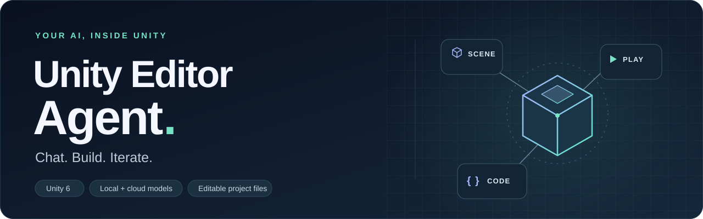

<p align="center"></p>
<p align="center"><a href="README.md">English</a> · <b>Русский</b></p>

**ScenePilot — ИИ-агент внутри Unity Editor.** Описывайте задачу обычным текстом: помощник изучает проект, выбирает инструменты, создаёт сцену и C#, получает результаты настоящей компиляции и проверяет поведение в Play Mode.

## Начало работы

1. Откройте Unity **6000.3**. Проверенная версия — **6000.3.27f1**.
2. В Package Manager выберите **Install package from Git URL**:

   ```text
   https://github.com/saslekawaiii/scenepilot-unity.git?path=/Packages/com.worldweaver.toolkit#v1.8.1
   ```

3. Запустите Ollama или добавьте своё API через форму подключения: базовый URL, точный ID модели и ключ при необходимости.
4. Откройте **Tools → ScenePilot → Chat**, выберите модель и напишите запрос. Доступны режимы «Спросить», «Спланировать» и «Выполнить», а также выбор бюджета рассуждения.

[Архив пакета](https://github.com/saslekawaiii/scenepilot-unity/releases) · [Модели Ollama](docs/local-models.md) · [Новое API](docs/custom-api.md) · [Обновление аддона](docs/updating.md)

Для произвольных операций через Unity API и автономного импорта C# нужны соответствующие разрешения в настройках проекта. Такой код выполняется с полномочиями редактора; просматривайте исходники и используйте доверенные проекты.

## Возможности

- Создание и изменение Terrain, собственных мешей, объектов, материалов, света и физических компонентов.
- Генерация C#, действительная компиляция Unity, назначение компонентов и продолжение после перезагрузки домена.
- Поиск первоисточников через `smolagents`, получение поддерживаемых ассетов и сохранение происхождения файлов.
- Проверки в Play Mode: измерения, утверждения, виртуальная клавиатура и мышь, наблюдение до двух минут.
- Состояние задачи, контроль ручных конфликтов, общие резервные данные по SHA-256 и ограниченное восстановление после неудачных шагов.
- Диагностика геометрии, маршрута UI-ввода и совместимости материалов с активным render pipeline. Снимки сцены убирают известные временные добавления pipeline, сохраняя строгую защиту ручных изменений.
- Управляемые персонажи, свободные диалоги NPC, профили моделей, память, навигация и игровые действия.

В справочной библиотеке — **114 MD-навыков** и **466 рецептов Unity API**. Количество справочных материалов не считается показателем успешности агента.

## Что проверено

**Проверка предварительной версии 1.8.1 завершена на зафиксированном пакете RC20** в Unity 6000.3.27f1. В [протоколе версии](docs/validation/1.8.1/README.md) указан точный SHA пакета и отдельно учтены программные проверки, реальные запросы модели, сохранённые результаты и изображения из Unity.

| Проверка | Пройдено | Ошибок | Пропущено |
| --- | ---: | ---: | ---: |
| Editor | 958 | 0 | 7 |
| Play Mode | 27 | 0 | 2 |
| Python-инструменты | 16 | 0 | 0 |
| Ожидаемые результаты runtime-проб | 11 | 0 | 0 |
| Отдельный запуск с URP и сохранённые результаты | 44 | 0 | 0 |

Семь пропусков Editor относятся к URP; все семь успешно выполнены в отдельном запуске с URP. Две проверки Play Mode требуют внешних провайдеров и не считаются пройденными. Наборы частично пересекаются: их суммы не являются количеством выполненных пользовательских задач.

Новый запрос RC20 на поиск документации завершился за три обращения к модели: открыты две официальные страницы Unity, все 287 наблюдаемых файлов проекта и контрольный отпечаток сцены остались неизменными. **Продолжение исправления меша из RC17** и **сохранённые дверь и счётчик из RC3** прошли независимые проверки на RC20, включая физику, ввод и реальное изображение меша. Исходные версии модельных запусков сохранены; эти результаты не выдаются за новую генерацию сцен на RC20.

Новая версия добавляет измеряемую диагностику мешей, UI-ввода и материалов. Успешное создание геометрии или физическая проба сами по себе не подтверждают правильное отображение материала.

Неудачный запрос на полый меш с остановкой после повторных шагов относится к **1.8.0** и сохранён в [историческом протоколе](docs/validation/1.8.0/README.md#unseen-rc23-case-that-still-fails). Прежние примеры склада, UI, точных правок, подъёмника и физики также остаются приписанными своим исходным кандидатам; они не выдаются за свежие успехи 1.8.1.

Возможности и скорость зависят от модели и проекта. Эти испытания не доказывают выполнение любого запроса, художественное качество или замену разработчика. Модельные API и их тарифы предоставляются отдельно от пакета.

## Совместимость

Идентификатор пакета `com.worldweaver.toolkit`, C#-пространства имён и старые пути данных сохранены, чтобы существующие сцены и история чатов продолжили работать. Старый пункт **Tools → WorldWeaver → Чат** также доступен. Установленный Git/TGZ-пакет обновляется явно через Package Manager.

## Дальше

[Архитектура](docs/architecture.md) · [Документация](README.md#documentation) · [Планы](ROADMAP.md) · [Сообщить об ошибке](https://github.com/saslekawaiii/scenepilot-unity/issues/new/choose)

Сторонние компоненты сохраняют свои лицензии. Общая лицензия на повторное использование авторского кода пока не назначена: [подробности](docs/LICENSING.md).
