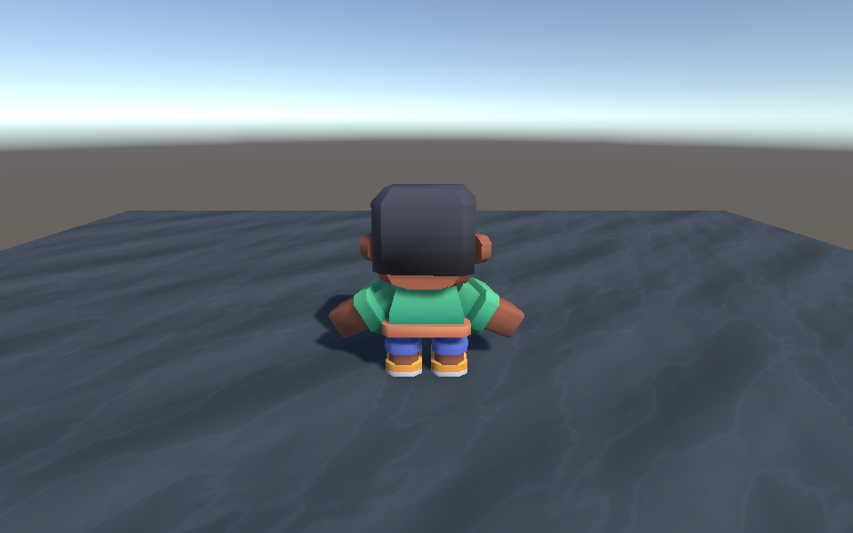

# Исправление создания анимированного героя

Запрос пользователя от 1 ноября 2026 года не работал в 1.3.0. Qwen 9B остановилась на общем лимите Fast 120 с. Бесплатный облачный маршрут вернул 1500 выходных токенов и оборвал JSON внутри исходника C#. До обрыва модель предлагала обычного NPC. Карточка «План подготовлен» ошибочно выглядела положительной при обоих сбоях. Первичная история сохранена приватно; её личный контекст не входит в репозиторий.

## Новый инструмент

`create_animated_player` создаёт или обновляет управляемого героя из двух встроенных стилизованных моделей Kenney Mini Characters. Это импортированные FBX с двумя skinned mesh, семью костями и авторскими клипами. Контроллер подключает Idle/Walk/Sprint, Jump/Fall и получает скорость фактического перемещения. Модели распространяются по CC0; [происхождение и SHA](../results/animated-character-source-integrity.json), лицензия и исходный архив указаны рядом с ассетами в пакете.

Пример обычного сообщения:

> Создай персонажа: сделай главного героя не используй примитив. используй реальную модель. добавь ей анимации ходьбы, передвижения и тд

Агент получает небольшой инструмент вместо необходимости писать риг, загрузчик и контроллер большим JSON с C#. Инструмент не создаёт произвольную фотореалистичную модель по описанию. Для своего ассета остаётся каталог prefabs проекта. В текущем инструменте выбраны два встроенных пресета `adventurer` и `explorer`.

Управление в Play Mode: WASD — движение, Shift — бег, Space — прыжок, правая кнопка мыши — поворот, E — разговор. Существующие WorldPlayer, Inventory и камера переиспользуются. При отсутствии физического пола создаётся отдельная небольшая площадка просмотра. Это демонстрация персонажа, а не сгенерированная законченная игра.

## Достоверность результата

Для запроса настоящего анимированного главного героя добавлено отдельное проверяемое требование. Успешный результат инструмента сопоставляется с живой целью сцены: проверяются skinned mesh, кости, текстура, клипы, фактически подключённый BlendTree, CharacterController и камера. Пустой ответ или создание примитивного NPC не проходят это условие. Структурная проверка в редакторе отдельно обозначена и не выдаётся за испытание управления.

Карточка задачи учитывает ошибку, отмену, таймаут и неприменённый план. Зелёное состояние допускается только при завершённом обращении с результатами всех имеющихся проверок; отсутствие критериев не означает успех.

Адаптеры сохраняют `finish_reason`/`done_reason`. Ответ, остановленный из-за лимита, не исполняется даже при формально закрытом JSON. В пределах общего времени доступна одна дополнительная попытка подготовки; незавершённый код заменяется новым полным планом с одним уже разрешённым `draft_script`. Просмотр кода остаётся обязательным. Исходный обрезанный ответ сохраняется в истории, а не достраивается программно.

## Совместимость ввода и сцены

Контроллер и окно разговора используют общий `WorldInput`. Он читает активный новый Input System либо прежний Input Manager; настройка проекта не переключается. В пакете явно объявлен Input System 1.20.1 — [выпущенная версия для Unity 6000.3](https://docs.unity.com/en-us/engine/6000.3/manual/packages-list/packages-all/pack-safe/com-unity-inputsystem). Чтение устройств следует [официальному API Unity](https://github.com/Unity-Technologies/InputSystem/blob/develop/Packages/com.unity.inputsystem/Documentation~/read-devices-directly.md). Для плавных малых шагов CharacterController использует `minMoveDistance=0`. Импортированные кости и меши зарегистрированы как собственные объекты для транзакции, бюджета и Undo.

## Проверки

| Проверка | Результат | Квитанция |
| --- | --- | --- |
| EditMode при новом Input System | 645/645 | [XML](../results/character-workflow-edit-newinput-1.3.1-r6.xml) |
| PlayMode при старом Input Manager | 22/22 | [XML](../results/character-workflow-play-legacy-1.3.1-r2.xml) |
| PlayMode при новом Input System | 23/23 | [XML](../results/character-workflow-play-newinput-1.3.1-r6.xml) |
| Точный запрос, Qwen 3.5 9B, Fast | План и применение 27,1 с; движение и анимации PASS | [JSON](../results/character-chat-9b-fast-r5.json) |
| Точный запрос, бесплатный GPT-OSS, Fast | План и применение 6,5 с; движение и анимации PASS | [JSON](../results/character-chat-cloud-fast-r1.json) |
| Чистая установка TGZ в копию реального URP-проекта | PASS; нормальный WorldPlayer.Update читает программную клавиатуру Input System; URP/Lit, рендер, ходьба, бег, прыжок и приземление | [JSON](../results/character-chat-user-urp-virtualinput-r1.json) |

В последней проверке движения не задаются через Transform или прямые вызовы MoveFrame: очередь состояний тестового Unity Keyboard обрабатывается обычным игровым Update. Рендер получен настоящим URP через [RenderPipeline.StandardRequest](https://docs.unity.com/en-us/engine/6000.3/script-reference/unityengine/rendering/renderpipeline/standardrequest). Это программная проверка ввода, не нажатия на физической клавиатуре и не проверка IME.

Два первых натурных запуска выявили слишком большой контекст и отклонение разрешённого пустого имени; третий — незарегистрированную импортированную иерархию; четвёртый и отдельный повтор движения — потерю малых шагов CharacterController. Неудачные JSON и рендеры сохранены рядом с финальными квитанциями. Первый общий прогон выполнялся одновременно с правками и дал 9 сбоев; повтор на замороженных исходниках прошёл. Промежуточные тесты виртуальной клавиатуры уточнялись с учётом обычного цикла обновления и отсутствия фокуса Game View в batch-режиме.

Mac заблокирован, поэтому финальное окно открытого пользовательского редактора и физические клавиши проверить не удалось. В пользовательском проекте подготовлена отдельная сцена `Assets/WorldWeaverGenerated/Scenes/AnimatedHero-Demo-1.3.1.unity`; исходная SampleScene сохранена. Обновление зависимости будет прочитано редактором при возобновлении работы. Один успешный запрос на каждой модели не является измерением надёжности произвольных задач; время внешнего API также может зависеть от серверного кэша.
