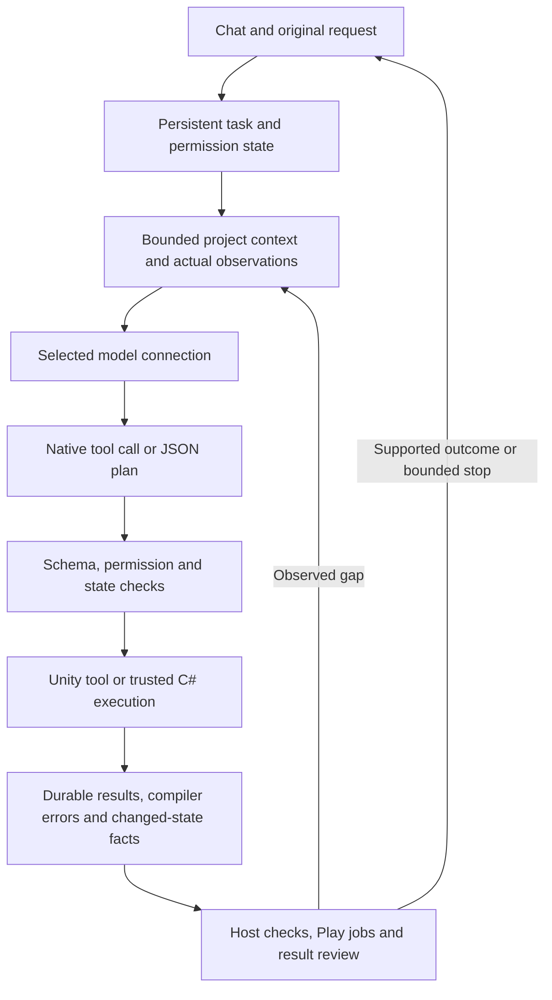

# Unity Editor Agent architecture

Unity Editor Agent is a Unity package with an Editor-side agent loop and runtime gameplay systems. Models propose work; the host validates and executes it. A tentative plan cannot expand the original user request or its permissions.

## Request and evidence flow

**Ask** has explanation purpose and exposes read-only tools. **Plan** retains implementation criteria but defers mutation until approval. **Execute** applies permitted operations. Literal question text stays in the original request; mentioning a player, script or object count in an explanation does not automatically create an authoring criterion.

## Code map

Paths are relative to `Packages/com.worldweaver.toolkit`:

| Component | Responsibility |
| --- | --- |
| [ChatController partials](../Packages/com.worldweaver.toolkit/Editor/Assistant/ChatController.cs) | Request construction, mode-aware wire contracts, model calls, stage progression and completion. |
| [ProjectContextIndex](../Packages/com.worldweaver.toolkit/Editor/Assistant/ProjectContextIndex.cs) | Bounded queries over current objects, assets, scripts and types. |
| [SceneToolExecutor](../Packages/com.worldweaver.toolkit/Editor/Assistant/SceneToolExecutor.cs) | Tool validation, scene transaction, rollback and structured result receipts. |
| [EditorCodeTools](../Packages/com.worldweaver.toolkit/Editor/Assistant/EditorCodeTools.cs) | Actual Roslyn compilation and execution of permitted Editor snippets. |
| [ScriptDrafts](../Packages/com.worldweaver.toolkit/Editor/Assistant/ScriptDrafts.cs) / [source patches](../Packages/com.worldweaver.toolkit/Editor/Assistant/AgentSourcePatches.cs) | Reviewed runtime-source changes, real compilation and attachment workflow. |
| [AgentEditorJobs](../Packages/com.worldweaver.toolkit/Editor/Assistant/AgentEditorJobs.cs) | Durable Unity jobs, test results, Play checks and runtime probes. |
| [AgentCheckpoints](../Packages/com.worldweaver.toolkit/Editor/Assistant/AgentCheckpoints.cs) | Hash-verified supported restoration and shared backup content. |
| [Runtime](../Packages/com.worldweaver.toolkit/Runtime) | Player control, NPC dialogue/actions, memory, retrieval and navigation. |

Package and assembly identifiers still use `WorldWeaver` for compatibility with released projects. The public repository name is `unity-editor-agent`; a documentation rename does not rewrite serialized types or the immutable 1.8.1 archive.

## Progress, recovery and completion

An unchanged read is evidence, not implementation. Successful Editor observations carry command/state fingerprints; replaying the same current observation can be rejected. A persisted, passed stage review starts the next stage's observation budget only after the host advances that stage. Failed reviews, new plans and new job IDs do not reset the budget.

A bounded fresh inference epoch can drop a stale provider continuation while retaining the original scope, actual artifacts and durable observations. The active native-function or JSON response contract stays consistent through recovery. Semantic tool errors do not automatically mean native transport is broken.

Failed compiler receipts retain measured diagnostics and bounded excerpts from the actual generated source, with line/column and source hash. Batch rollback preserves structured result fields and marks their pre-rollback scope; it does not turn them into current-state readback. A later implementation change makes earlier behavioral findings historical and requires fresh relevant checks.

An explanation can recover from a failed discovery route after a later clean read-only result and a nonempty final answer. This narrow policy preserves failed rows and does not absolve failed required reads, behavioral checks, compilation or mutations. Provider exceptions and cancellation still terminate through their own error paths.

A separate model review compares the request with current host facts. It is another inference, not deterministic proof. Runtime measurements and independent artifact acceptance remain distinct layers. See the [release validation](validation/1.8.1/README.md) for the evidence actually collected.

## Runtime probes and trust

`run_runtime_probe` compiles a bounded iterator, enters real Play Mode and provides measured `Record`/`Check` operations plus temporary Input System devices. The wall budget is 0.25–120 seconds. Empty checks, failed assertions, exceptions, timeouts and cancellation do not produce success. The job exits Play Mode and restores the Editor scene before its final result.

Yield-based timing cannot interrupt blocking synchronous C#. Editor snippets execute with full Editor permissions. Enabling autonomous code is a trust decision; it is not a sandbox. Context files, downloaded pages, MD skills and tool results remain untrusted data and cannot grant extra permissions.

## Checkpoint boundary

Supported snapshots are limited to **300 MiB**, **20,000 files**, **one to eight loaded scenes** and a **2 GiB** shared content pool. Identical content is stored by SHA-256. Save untitled additive scenes before checkpointing; scenes with baked lighting are outside the current supported boundary. Manual conflicts stop automatic continuation.

Checkpoints cover supported scene/file changes and the sealed write set. They do not back up `Library`, model weights or arbitrary external side effects of code. Development QA reuses existing consumer projects and limits concurrent Editors; process guards must not terminate a user's separate Editor session.

## External components

The optional researcher uses Hugging Face `smolagents` with search/page-reading tools. Skill and recipe catalogs include attributed, pinned Unity references; those references are advisory and do not install their upstream MCP/REST tools. MCP for Unity and OpenHands informed the research, but are not bundled agent runtimes. Imported assets retain their source/license records. See [licensing](LICENSING.md), [Unity recipes](unity-recipes.md) and [the maintainer guide](MAINTAINING.md).
