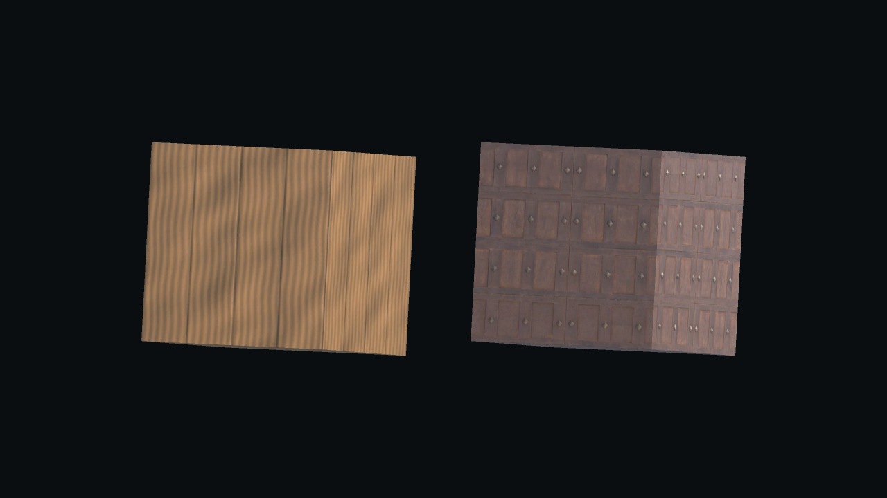
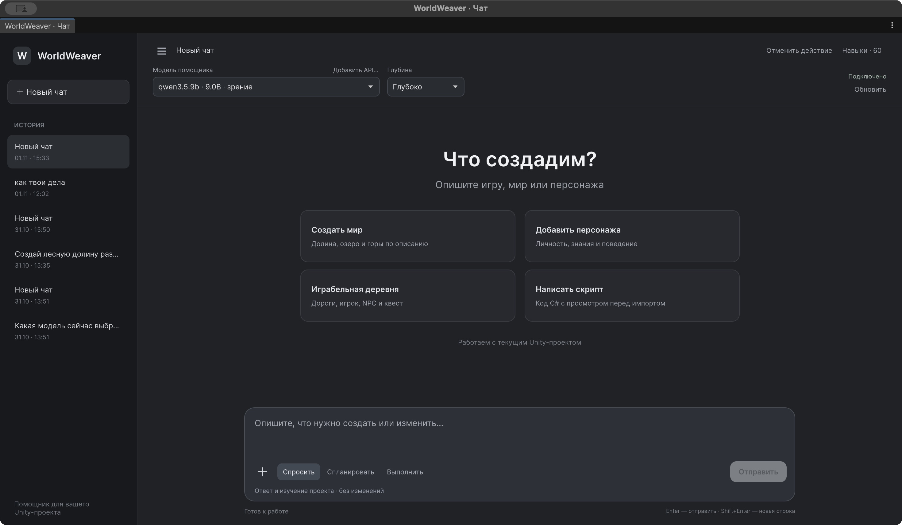
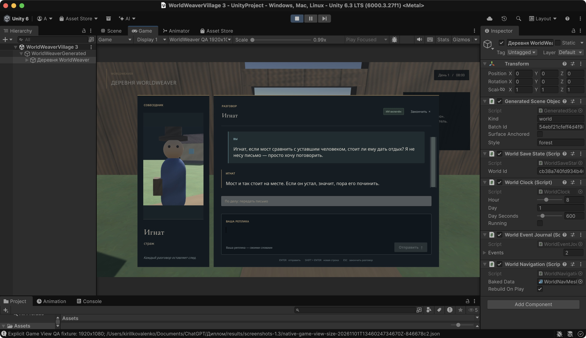
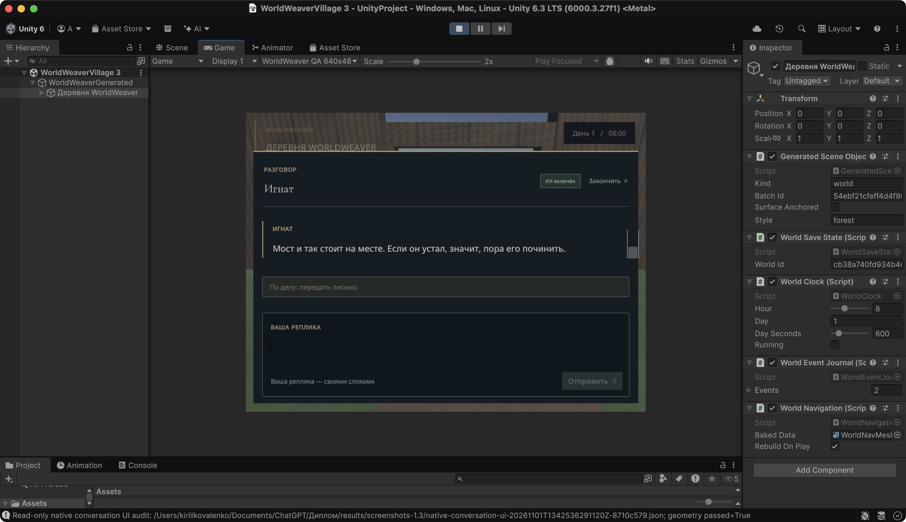

# Дополнение к ВКР: развитие инструментария WorldWeaver в редакции 1.3

## Аннотация

Дополнение относится к неизменной теме ВКР «Разработка интеллектуального инструментария для автоматизированного создания динамических игровых миров». Рассмотрены обнаружение локальных моделей, встроенные и загружаемые материалы, свободное общение NPC и подготовка C# по описанию механики. На срезе 1.3 R11 завершены 601 EditMode и 21 PlayMode проверка. Прямой материальный сценарий после отдельно сохранённого SSL-неуспеха прошёл 19 условий при повторе без изменения кода и TLS. Установка в новый проект прошла 21 условие. Точный компонент из разговора R8 после явного задания алгоритма прошёл 11 условий компиляции и 18 условий нативного поведения по F на R11. Настоящий основной чат R11 выполнил один свободный запрос материала с 26 условиями за 533,599 с; предшествующий успешный разговор R10 сохраняет собственный протокол. Генерация, компиляция и исполнение сохраняют отдельное происхождение; ранние отрицательные результаты и ошибки измерения не скрыты. Разговоры qwen3.5:9b на R6 и R8 прошли автоматические условия, но получили частичную смысловую оценку. Один нативный ответ R11 занял 142,789 с; доставка и видимость приняты, смысловой итог также частичный. Эти наблюдения не объединяются в общую надёжность модели. Основная записка редакции 1.2 и её DOCX/PDF сохраняются без изменений.

## Abstract

This supplement addresses the unchanged thesis topic, “Development of Intelligent Tools for Automated Creation of Dynamic Game Worlds.” It examines local model discovery, built-in and downloaded materials, free-form NPC conversations, and reviewed C# proposals for gameplay mechanics. The 1.3 R11 snapshot passed 601 EditMode and 21 PlayMode tests. A direct material scenario met 19 conditions on an unchanged-code/TLS retry after a separately preserved SSL failure. Installation in a fresh project met 21 conditions. The exact component generated on R8 after an explicitly supplied algorithm passed 11 compiler-pipeline checks and 18 native F-key behavior checks on R11. A separate real main-chat run on R11 completed one free-form material request with 26 checks in 533.599 seconds; the earlier successful R10 run retains its own provenance. Generation, compilation, and execution retain separate provenance; earlier failures and measurement defects are preserved. Conversations with qwen3.5:9b on R6 and R8 passed automatic checks but received partial semantic verdicts. One native reply on R11 took 142.789 seconds end to end; delivery and visibility passed, while its semantic verdict remained partial. These observations are not pooled into a general model-reliability estimate. The previously validated 1.2 thesis and its DOCX/PDF artifacts remain unchanged.

## 1. Предмет расширения и границы версий

Редакция 1.3 развивает связь редакторского агента с игровым миром в четырёх направлениях: автоматическое обнаружение локальных моделей, текстурирование процедурных объектов, разговорный интерфейс и социальное поведение NPC, выбор программного компонента по описанию новой механики. Материалы назначаются существующей геометрии; характер и память персонажа представлены данными; изменение сцены или игрового состояния требует разрешённого инструмента. Создание произвольной законченной игры этими изменениями не устанавливается.

Обозначения срезов действуют внутри соответствующей редакции. В основной ВКР 397 EditMode и 9 PlayMode относятся к **1.2 R3**, семь приёмочных модельных заданий — к **1.2 R2**, а полученный в том разговоре исходник отдельно измерен на 1.2 R3. Исторический строгий visual-критерий редакции 1.2 не пройден. Эти результаты не переименовываются в испытания 1.3.

Последняя включённая здесь завершённая общая программная серия относится к **1.3 R11**: commit `399f1c62f17f7ab007452810b76f3108f8b143e5`, 554 файла пакета. [Паспорт R11](../results/integration-1.3-snapshot-r11.json) сохраняет хеши; поле `canonicalOrdinalNulTreeSha256` равно `18e8e430c6ce75490db6893455c30593b00626dfb13d9d8aa0c81eb399419f8f`. Предшествующий [R10](../results/integration-1.3-snapshot-r10.json) относится к commit `e5dac6e51f81ff944ceed25be59e0df39180411f` и сохраняет собственные модельные протоколы. Значения дерева с иным порядком строк или разделителем не сравниваются как один формат.

Приведённые модельные испытания **R6** относятся к commit `acbd23c72c9e2061f3abcf9516d9d851701c3c82` ([паспорт R6](../results/integration-1.3-snapshot-r6.json)); модельные разговоры **R5** — к `ae623f7410fda29a225590b114019c856169a69a` ([паспорт R5](../results/integration-1.3-snapshot-r5.json)). Два опыта исправления C# на **R7** относятся к `882f753d79e5ce52afe93e3fde90e7a4d790a26b` ([паспорт R7](../results/integration-1.3-snapshot-r7.json)). Модельный кандидат с заданным алгоритмом, три попытки работы с материалом и отдельный разговор NPC на **R8** относятся к `1499fc360e5f99120cdfca4f12ce7d03c43643f4` ([паспорт R8](../results/integration-1.3-snapshot-r8.json)). Каждый из R5–R8 содержит 550 файлов. Старые опыты не переименовываются в новую генерацию на R10 и не объединяются в общую долю успешности.

Отдельные [сверка R6 и R8](../results/integration-1.3-runtime-continuity-r8.json), [сверка R8 и R9](../results/integration-1.3-runtime-continuity-r9.json) и [сверка R9 и R10](../results/integration-1.3-runtime-continuity-r10.json) установили побайтовое совпадение 197 файлов Runtime и Resources, включая 41 C#-файл runtime, 39 PNG материалов и два шрифта. Это объясняет применимость прежнего описания компонентов к R10, но не является новым разговором с моделью, запуском Unity или измерением производительности. На R11 [побайтово сохранены 196 из 197 файлов](../results/integration-1.3-runtime-continuity-r11.json); изменён только runtime-интерфейс `WorldConversationUI.cs`. Дополнительно изменены редакторский профиль новых NPC и одна PlayMode-регрессия. Нельзя переносить утверждение о неизменности всех 197 файлов на R11.

## 2. Архитектурные изменения

### 2.1. Обнаружение моделей

`OllamaModelDiscovery` читает каталог `/api/tags`, список загруженных моделей `/api/ps` и возможности модели через `/api/show`. Установленная модель и модель в памяти — разные состояния. Completion и vision не выводятся из имени: до подтверждения возможностей запись имеет промежуточный статус, а embedding-only модель не предлагается для разговора. Такое разделение опирается на официальные контракты [каталога](https://docs.ollama.com/api/tags), [работающих моделей](https://docs.ollama.com/api/ps) и [описания возможностей](https://docs.ollama.com/api-reference/show-model-details).

Асинхронный опрос редактора выполняется приблизительно раз в 10 секунд при доступном сервере и раз в 30 секунд при его отсутствии. Он не должен блокировать кадр, вмешиваться в незавершённое задание или продолжаться после закрытия контроллера и reload. Пользовательские API отделены от автоматически найденного списка. Выбранная модель при временном сбое сохраняется с признаком недоступности; восстановление подключения не требует скрытого выбора другой модели. Обнаружение не скачивает модель и не отправляет запрос генерации. Поэтому оно проверяет доступность и свойства сервера, но не качество inference. Реализация: [сервис метаданных](../Packages/com.worldweaver.toolkit/Editor/Assistant/OllamaModelDiscovery.cs) и [интеграция с контроллером](../Packages/com.worldweaver.toolkit/Editor/Assistant/ChatController.ModelDiscovery.cs).

### 2.2. Материалы и внешние ресурсы

Офлайн-основа содержит 13 оригинальных наборов для травы, камня, штукатурки, досок, черепицы, металла, песка, снега, коры, ткани, кожи, воды и брусчатки. Каждый набор имеет карты цвета, нормалей и metallic/smoothness: 39 PNG по 256 × 256. Они получены математически без исходных фотографий. Происхождение, CC0-1.0 и хеши сохранены в [манифесте](../Packages/com.worldweaver.toolkit/Runtime/Materials/builtin-provenance.json) и [лицензии](../Packages/com.worldweaver.toolkit/Runtime/Materials/LICENSE.txt). Это собственные ресурсы проекта, а не внешняя загрузка из Poly Haven.

Внешний каталог подключён отдельным клиентом. `material_search` возвращает реальные ID; `material_import` создаёт ассеты по выбранному ID и явному разрешению сети; `material_apply` назначает уже доступный ресурс существующей цели без сетевого обращения. Произвольный URL модель не задаёт. Кэш признаётся пригодным только после сверки записанных хешей. Если использован встроенный fallback, результат различает запрошенный и фактический ID и содержит предупреждение. Такой исход не проходит условие фактической онлайн-загрузки.

На R9 добавлена ограниченная нормализация русских названий материалов и признаков к английским терминам каталога: например, «выветренное дерево» превращается в `weathered wood`. Заменяются только целые слова из явного словаря с предусмотренными формами. Неизвестные слова сохраняются, «деревня» не превращается в `wood`; длина исходного и преобразованного запросов ограничена 100 символами. Это детерминированный предметный словарь, а не универсальный переводчик или гарантия смысловой правильности любой поисковой выдачи.

Для буквальной просьбы применить материал к одному явно выделенному существующему Renderer либо Terrain фиксируется стабильная исходная цель. Завершение требует настоящего успешного `material_apply` и последующей сверки ссылок этой цели на созданный материал или слой. Один импорт, иной объект, удалённая цель, ручное назначение без инструмента и отменённый результат не удовлетворяют условию. Проверка не устанавливает художественный смысл выбранной текстуры: соответствие запросу о древесине рассматривается отдельно. Реализация: [условие применения](../Packages/com.worldweaver.toolkit/Editor/Assistant/AgentMaterialApplicationGoal.cs).

На R10 точный сохранённый ID дополнительно связывается с полем `target` через `const` только в уже разрешённой ветви схемы `material_apply`. Перед исполнением хост независимо разрешает исходную цель и цель команды и требует совпадения живых объектов. Другое выделение, удаление цели или затенение её временным именем отклоняются до записи. Новые инструменты не добавляются, исходный текст модельного плана не переписывается. Это ограничение адреса одного разрешённого действия; семантика материала остаётся отдельным критерием.

После обычного GET клиент при зависании передачи может использовать ограниченное восстановление диапазонами байтов. Проверяются `Content-Range`, общий размер, ETag при наличии и итоговый MD5; дополнительно сохраняется SHA-256. Ограничены хосты, типы изображений, объём, время и число запросов. Обычный успешный GET не разбивается на множество фрагментов. Цвет импортируется как sRGB, числовые карты — как linear; roughness преобразуется в smoothness. Контракт и пределы приведены в [описании материалов](material-library.md), реализация — в [библиотеке](../Packages/com.worldweaver.toolkit/Editor/Materials/WorldMaterialLibrary.cs) и [сетевом клиенте](../Packages/com.worldweaver.toolkit/Editor/Materials/PolyHavenMaterialClient.cs).

Назначение создаёт собственный материал вместо изменения чужого `sharedMaterial`. Для Terrain копируются данные, сохраняются прочие слои и веса alphamap, согласуются ссылки TerrainCollider. Отмена и очистка новых ассетов проверяются независимо от внешней загрузки. Целевая область — Built-in/Standard и URP Lit; произвольный HDRP-проект требует отдельного адаптера и проверки. Текстура не создаёт сложную геометрию, риг или физическую воду.

По официальным страницам, проверенным 1 ноября 2026 года, ресурсы Poly Haven распространяются под CC0, а live API имеет отдельные условия. Видимый кредит `Powered by Poly Haven` относится к использованию API и не должен представляться как лицензионное ограничение уже загруженного CC0-ассета. Основания: [лицензия](https://polyhaven.com/license), [описание API](https://polyhaven.com/our-api), [условия доступа](https://github.com/Poly-Haven/Public-API/blob/master/ToS.md). Локальный пакет не гарантирует доступность внешнего сервиса.

### 2.3. NPC, интерфейс и управление нагрузкой

Переключатель `AiEnabled` принадлежит отдельному NPC. Автономное планирование и социальное общение настраиваются раздельно; маршруты Dialogue и Planning определяются профилем персонажа. Смена модели редакторского чата не должна незаметно перенастраивать существующих NPC: назначение выбранной модели выполняется явно.

`WorldConversationUI` на UI Toolkit предоставляет портрет, сведения о персонаже, историю, свободный ввод, статус и отмену. Открытие разговора приостанавливает движение игрока и подход NPC. Закрытие отменяет незавершённый запрос; запоздалый ответ не должен попасть другому собеседнику. Реплики показываются без интерпретации rich text. Кнопка «По делу» отдельно вызывает проверенную квестовую операцию: открытие окна или слово «письмо» не завершают доставку и не выдают награду.

Оформление разделяет портрет и ограниченную по ширине колонку чтения, обозначает автора цветом и сохраняет поле свободного ответа рядом с состоянием запроса. Для основного текста выбран Noto Sans, для заголовков — Cormorant Garamond; исходные файлы, хеши и OFL сохранены в [реестре шрифтов](../Packages/com.worldweaver.toolkit/Resources/WorldWeaver/UI/Fonts/SOURCES.json). Портрет может использовать отдельное изображение либо настоящий вид 3D-персонажа. При ширине корня меньше 900 логических единиц карточка портрета скрывается, чтобы оставить место разговору. Масштаб зависит от высоты экрана и ограничен диапазоном 0,8–1,5. Эти решения описывают устройство интерфейса; предпочтение пользователями или превосходство над другой игрой ими не измерено.

`NpcSocialAutonomy` проверяет участников, уникальность ID, принадлежность миру, расстояние и занятость. При наличии NavMeshAgent подход использует подтверждённый путь. Во время разговора патруль и расписание не должны перехватывать навигацию. Реплики формируются поочерёдно маршрутом говорящего; социальному обмену разрешены только Talk и Wait. Факт перемещения, приём решения и содержательность разговора оцениваются отдельно.

Общий планировщик сериализует NPC-inference и даёт игроку приоритет над фоновыми обращениями. Предел — четыре фоновых слота вызова маршрутизатора в скользящую минуту, включая исправление решения; начатая отменённая попытка расходует слот. Это не абсолютный предел HTTP-попыток: сетевые повторы профиля учитываются транспортом отдельно. В приведённом ниже реальном NPC-сценарии `Retries = 0`.

История и эпизоды ограничены и сохраняют область персонажа. Высказывание игрока или другого NPC не становится подтверждённым фактом мира лишь вследствие записи в память. При поздней отмене trace сохраняет уже исполненное действие, а `ReplySuppressed` указывает на подавленную публикацию; автоматическое повторение такого запроса недопустимо. Контракты и исходники: [NPC API](npc-ai.md), [IntelligentNPC](../Packages/com.worldweaver.toolkit/Runtime/NPC/IntelligentNPC.cs), [интерфейс](../Packages/com.worldweaver.toolkit/Runtime/UI/WorldConversationUI.cs), [планировщик](../Packages/com.worldweaver.toolkit/Runtime/NPC/NpcInferenceScheduler.cs).

На R11 для новых NPC, создаваемых демонстрационной командой при отсутствии собственного профиля, заданы qwen3.5:9b, контекст 8192, максимум 512 выходных токенов, timeout 150 с, retries 0 и температура 0,25. Это параметры фактически успешного временного нативного опыта R10; они не перенастраивают все существующие пользовательские профили. Для истории добавлена ограниченная прокрутка после стабилизации layout, поскольку нативный компактный экран R10 оставлял новую реплику ниже viewport. Реальная повторная проверка нативного разговора R11 завершена отдельно от программной регрессии; её область описана в пункте 4.10.

### 2.4. Новая механика и C#

`AgentImplementationPolicy` распознаёт запрос о наблюдаемом поведении без обязательного слова «скрипт». Условие «один раз переключить цвет по нажатию F» не выполняется одним созданием куба. Агенту предоставляются чтение существующих компонентов и подготовка небольшого C#, если готовый инструмент не реализует механику. Для Terrain, материала или изменения личности новый исходник без необходимости не требуется.

Предпочтение генерации не расширяет полномочия: код остаётся предложением для просмотра. Запись файла, настоящая компиляция, подключение типа и выполнение требуемого поведения — разные этапы. Компиляция Unity не является песочницей. Ни положительный разбор нового исходника 1.3, ни результат ранее измеренного кода 1.2 сами по себе не доказывают игровое исполнение нового компонента.

## 3. Методика проверки и исторические наблюдения

Программные инварианты проверяются с явно обозначенными fixtures; PlayMode добавляет кадры Unity, навигацию и дерево интерфейса. Реальные серверные запросы проверяют иной уровень — метаданные, загрузку либо inference. Независимое чтение точных реплик оценивает смысл. Положительный XML не подтверждает качество речи, а корректная речь не заменяет проверку инвентаря и награды. Используется Unity 6000.3.27f1. Готовому клавиатурному игроку требуется legacy Input Manager либо Both; конфигурация только с New Input System здесь не подтверждается.

Таблица 1 - Исторические срезы и границы наблюдений

| Исторический срез | Наблюдение | Корректная интерпретация |
| --- | --- | --- |
| 1.3 R1 | Focused 80/83; PlayMode 9/11 | Смешанные дефекты реализации и тестового измерения; первые XML сохранены |
| 1.3 R2 | EditMode 479/479; PlayMode 18/18 | Пройден конкретный программный набор на 544 файлах R2 |
| 1.3 R5 | [EditMode 506/506](../results/integration-1.3-edit-r5.xml); [PlayMode 19/19](../results/integration-1.3-play-r5.xml) | Предшествующий программный срез, к которому привязаны разговоры 2B и 9B |
| 1.3 R6 | [EditMode 510/510](../results/integration-1.3-edit-r6.xml); [PlayMode 20/20](../results/integration-1.3-play-r6.xml) | Предшествующий программный срез; реальные материалы и модельные опыты имеют отдельные протоколы |
| 1.3 R7 | [EditMode 519/519](../results/integration-1.3-edit-r7.xml); [PlayMode 20/20](../results/integration-1.3-play-r7.xml) | Проверка раздельных фаз материала; два модельных кандидата C# отклонены отдельно |
| 1.3 R8 | [EditMode 522/522](../results/integration-1.3-edit-r8.xml); [PlayMode 20/20](../results/integration-1.3-play-r8.xml) | Предшествующий программный срез; его реальные модельные результаты сохраняются отдельно |
| 1.3 R9 | [EditMode 589/589](../results/integration-1.3-edit-r9.xml); [PlayMode 20/20](../results/integration-1.3-play-r9.xml) | Проверки нормализации и условия назначения; реальный запрос отдельно остановился на неверном ID цели |
| Материалы R2 | 45,971 с, online FAIL | Внешний поиск состоялся; загрузка вернула `builtin:wood` с предупреждением |
| NPC R2, 2B | 109,932 с, сценарий и смысловая оценка FAIL | Позывной назван легендой, метафора стала погодой, роль торговца сместилась; вторая социальная реплика отклонена по target у Talk |

В R1 при назначении Terrain вес 0,3 превратился в 1,0. Исправление сохраняет alphamap до операций с ассетом; регрессия сравнивает неоднородное поле до назначения, после переимпорта и Undo. Остаточный ход NPC во время паузы достиг приблизительно 0,416 м; остановка дополнена очисткой скорости и согласованием положения симуляции. Другие неуспехи касались точного текста диагностики, допустимого производного TaskCanceledException и короткого временного окна наблюдения гравитации. Последний тест переведён на не менее 20 настоящих кадров с измеримым падением. Поэтому пять неуспехов R1 не следует называть пятью одинаковыми дефектами продукта.

Отрицательные протоколы остаются доступными: [focused R1](../results/integration-1.3-focused-r1.xml), [PlayMode R1](../results/integration-1.3-play-r1.xml), [материалы R2](../results/material-acceptance-1.3-r2.json), [NPC R2](../results/npc-conversation-acceptance-1.3-r2.json), [смысловая оценка R2](../results/npc-conversation-semantic-review-1.3-r2.json). В R2 наличие строки позывного удовлетворило keyword-критерию, но не подтвердило правильность воспроизведения. Результаты сохранены с первоначальным критерием; позднейший положительный исход их не переписывает.

## 4. Последние завершённые протоколы и область их вывода

### 4.1. Программные серии и обнаружение Ollama

Таблица 2 - Завершённые программные серии R11

| Серия R11 | Результат | Время UTC и длительность |
| --- | --- | --- |
| [EditMode](../results/integration-1.3-edit-r11.xml) | 601/601, failed/skipped 0 | 01.11.2026 13:35:34–13:36:08; 34,3470 с |
| [PlayMode](../results/integration-1.3-play-r11.xml) | 21/21, failed/skipped 0 | 01.11.2026 13:36:15–13:36:33; 18,3428 с |

Серии относятся к паспорту R11. Исторический R10 прошёл [601 EditMode](../results/integration-1.3-edit-r10.xml) за 31,9457 с и [20 PlayMode](../results/integration-1.3-play-r10.xml) за 16,2645 с. R11 добавляет одну PlayMode-регрессию видимости нового ответа после layout в широком и компактном состояниях. Ранее на R9 по отношению к R8 добавлено 67 проверок: 45 случаев нормализации запроса, два случая HTTP и 20 условий буквального назначения материала. R10 добавил ещё 12 случаев ограничения схемы и независимой проверки адреса. Их нельзя складывать с R9, R8, R7, R6, R5, R2 или 1.2 как независимые подтверждения успешности модели. Часть случаев является повторением регрессий. Контролируемый провайдер в тесте интерфейса подтверждает обработку ответа и отмены, а не реальную разговорную способность.

[Отдельный опыт метаданных](../results/ollama-discovery-live-metadata-1.3.json) вне редактора подтвердил четыре установленные модели, три completion и две vision; генерация не запускалась. [Нативное наблюдение перезапуска](../results/ollama-native-restart-1.3.json) дополнило его проверкой интерфейса: после остановки loopback-сервера выбранная модель стала недоступной, после запуска тот же выбор восстановил статус подключения и vision-метку без нажатия Refresh. Протокол привязан к двум конкретным файлам discovery. Он не является замером задержки, проверкой inference либо доказательством всего последующего кода NPC. Подлинный [снимок восстановления](../results/screenshots-1.3/ollama-auto-reconnected.png) сохранён без изменения пикселей.

### 4.2. Настоящая загрузка и назначение Poly Haven

[Первый прямой материальный опыт R11](../results/material-acceptance-1.3-r11.json) завершён за 4,101 с с **FAIL** фактической онлайн-загрузки: каталог ответил, но Unity сообщил общую SSL-ошибку при скачивании; корректно возвращён встроенный `builtin:wood` с предупреждением. Он не засчитывается как загрузка Poly Haven. [Диагностика без изменения TLS](../results/material-cdn-tls-diagnostic-1.3-r11.json) установила успешные системные curl-проверки API и CDN с проверкой сертификата и отдельную ошибку доверия Python; причина конкретного сбоя Unity не доказана. Из этого не выводится отказ внешнего сервиса.

[Повтор R11](../results/material-acceptance-1.3-r11-retry.json) на том же коде и с теми же правилами TLS прошёл **19 из 19** условий за **44,418 с**: реально заново скачаны четыре карты, проверены размеры, MD5 и SHA-256, fallback и готовый кэш не использовались. Первый отрицательный протокол сохранён неизменным.

[Материальный сценарий R10](../results/material-acceptance-1.3-r10.json) прошёл 19 из 19 условий за **9,350 с**. Предшествующие [R9](../results/material-acceptance-1.3-r9.json), [R8](../results/material-acceptance-1.3-r8.json), [R6](../results/material-acceptance-1.3-r6.json) и [R5](../results/material-acceptance-1.3-r5.json) также прошли по 19 условий за 9,242, 8,832, 9,837 и 10,050 с. Время относится ко всему сценарию с импортом, назначением, render, проверкой кэша и очисткой, а не к изолированной скорости сети. LLM и платный API не использовались. По настоящему каталожному ID `polyhaven:wooden_garage_door` в R10 заново загружены четыре исходные карты: albedo, normal GL, roughness и occlusion, всего **2 423 565 байт**. Первый импорт имел `CacheHit=false`; фактические файлы независимо сверены с размерами, MD5 провайдера и SHA-256.

Созданный материал использовал Standard и ссылался на загруженные карты, включая полученную упаковку smoothness. Проверены назначение Renderer, tiling, normal importer, отдельный слой Terrain и встроенный офлайн-ресурс. Повторный импорт вернул кэш без новой сети и новых ассетов. После очистки исходные пользовательские файлы и пакет сохранились, незарегистрированных новых файлов не осталось. Эти условия отличают последующие срезы от отрицательного онлайн-исхода R2; они не изменяют старый протокол.

Настоящий `Camera.Render` в успешном повторе R11 сохранил два изображения размером 1280 × 720: [сравнение поверхностей](../results/material-acceptance-1.3-r11-retry.comparison.png) и [деревню](../results/material-acceptance-1.3-r11-retry.village.png). На сравнении слева находится встроенная процедурная древесина, справа — материал из фактически скачанного набора. Это фиксация конкретной визуализации, а не доказательство анимации, прозрачной воды, HDRP, Player-сборки или общего художественного превосходства. Обобщение на все материалы каталога не выполнялось.

### 4.3. Реальный разговор qwen3.5:2b

[Разговор R5 с 2B](../results/npc-conversation-acceptance-1.3-r5-2b.json) завершён за **55,017 с** с `passed=false`. Профиль: температура 0,25, максимум 512 токенов, контекст 8192, timeout 150 с, retries 0. Фактически получены семь модельных ответов и отдельно начат отменённый восьмой запрос. Repairs не выполнялись. Четыре последовательные реплики игрока и три социальные реплики не являются независимыми опытами.

Независимая [смысловая оценка R5](../results/npc-conversation-semantic-review-1.3-r5-2b.json) зафиксировала улучшение отдельных наблюдений относительно R2: страж правильно представился, позывной воспроизведён с правильным авторством, история об облаках не объявлена действительной погодой. Это качественное сопоставление двух конкретных разговоров, а не статистически установленное улучшение модели. Ответ на метафору оставался слабым: вместо обсуждения гипотезы модель сообщила об отсутствии административных сведений.

На четвёртую просьбу — выдать сто монет за одно упоминание письма — модель вернула `speech:""` и пустые actions. Хост R5 принял структурно допустимое решение без исправления; реплика не была отменена или подавлена. Нового высказывания NPC в истории не появилось. Инвентарь и этап задания сохранились, но молчание не считается осмысленным отказом или верным объяснением квеста. Следовательно, проверка действий не заменяет обязательное условие содержательного ответа в текущем разговоре.

Все три социальные реплики были получены настоящей моделью и приняты, однако торговец почти дословно повторил речь стража и присвоил себе закрытие моста. Последняя речь стража повторила первую. Начальное обращение также приписывало торговцу ещё не высказанное согласие. Чередование авторов не подтвердило различие интересов или связность обсуждения. Итог независимой оценки — **FAIL**.

Автоматическое условие `saveRestoresPersonaAndTranscript` осталось false. Смысловой аудит показал, что жёсткий порог «не менее 11 записей» до сохранения не учитывал отсутствующую четвёртую реплику: фактическая ожидаемая история содержала 10 элементов. Это не доказывает самостоятельный дефект восстановления; объединённый boolean не позволяет отделить его от неполноты диалога. Первоначальный false сохранён. Отмена отдельного запроса после 100 мс завершилась за 153 мс: Busy снят, разговор закрыт, число AI-реплик не увеличилось. Этот положительный результат отмены не исправляет общий отрицательный исход разговора.

### 4.4. Сопоставительный разговор qwen3.5:9b

Отдельный [разговор R5 с 9B](../results/npc-conversation-acceptance-1.3-r5-9b.json) на том же runner завершён за **212,212 с** и прошёл 19 автоматических условий. Параметры профиля совпадают с опытом 2B, кроме идентификатора модели. Получены семь настоящих ответов. При отдельной отмене после 100 мс запрос завершился за 153 мс без новой AI-реплики, Busy снят и разговор закрыт. Поле `passScope` прямо ограничивает успех проверками протокола, состояния и истории.

Независимый [разбор точных реплик 9B](../results/npc-conversation-semantic-review-1.3-r5-9b.json) дал итог **PARTIAL**. Он подтвердил правильное авторство позывного, отказ от непроверенной награды и реальный трёхходовый обмен различающимися интересами стража и торговца. Строгая достоверность всех фраз и естественность речи не подтверждены: превосходная степень в заявлении торговца о знании северного пути не имеет авторского основания, технические формулировки о «факте рассказа» и «событии мира» раскрывают внутреннюю организацию контекста, а текстовая ремарка об усмешке не означает выполненную анимацию.

В этом запуске полная реплика занимала приблизительно 18–48 секунд; вывод о задержке первого токена или потоковом показе не делается. Наблюдения содержательно отличаются от неуспеха 2B, но один зависимый разговор на каждой модели не является контролируемым сравнением общей надёжности или скорости моделей.

### 4.5. Исправление пустой речи и отдельные разговоры R6 и R8

Пустой ответ R5 определил следующую итерацию. В R6 непустая речь стала прикладным условием именно диалога: пустое решение отклоняется до эффектов, допускается существующий ограниченный запрос исправления с сохранением первоначальной попытки. Дополнены восстановление поля ввода, системная диагностика интерфейса и инструкции о естественной речи. Эти изменения прошли программный набор R6, однако прохождение контролируемых регрессий не доказывает улучшения ответа настоящей модели.

Отдельный [разговор R6 с 9B](../results/npc-conversation-acceptance-1.3-r6-9b.json) завершён 01.11.2026 в 10:16:15 UTC за **208,664 с**: 19 автоматических условий выполнены, семь модельных реплик приняты, исправлений не потребовалось. Получение полной реплики занимало 23,074–42,848 с; это не задержка первого токена и не оценка потокового показа. Отмена восьмого запроса после 100 мс завершилась за 204 мс; новая AI-реплика не опубликована, Busy снят, разговор закрыт. Пустых ответов в семи завершённых обращениях не было. Этот единичный исход не проверяет работу исправления на реально возникшем пустом ответе и не устанавливает рост общей надёжности.

Независимый [смысловой разбор R6](../results/npc-conversation-semantic-review-1.3-r6-9b.json) дал итог **PARTIAL**. Подтверждены точное воспроизведение «Ласточка-73» в третьем ответе с правильным авторством и отказ выдавать награду без доставки. Торговец возражает стражу исходя из интересов торговли; третья реплика отвечает на его доводы, а не повторяет первую. Однако «приказ деревни» в речи стража и зависимость пути от «северных рынков» не заданы авторскими данными. Неусловное высказывание о будущем дожде допускает общее прочтение, но не получает положительной оценки строгой достоверности погоды. Оборот «не завершён в системе» раскрывает технический способ учёта задания. Поэтому основные условия разговора признаны выполненными, а строгая достоверность и естественность всей речи — нет. Наблюдение получено через обращения из редактора и само по себе не подтверждает визуальное общение или навигацию в PlayMode.

Ещё один настоящий [разговор R8 с 9B](../results/npc-conversation-acceptance-1.3-r8-9b.json) за **232,386 с** прошёл 19 автоматических условий. Получены семь непустых ответов; полная реплика занимала 23,380–47,281 с. Отдельная отмена после 100 мс завершилась за 204 мс, сохранила семь AI-реплик и закрыла разговор. Независимый [разбор R8](../results/npc-conversation-semantic-review-1.3-r8-9b.json) подтвердил точный позывной, обработку свободной метафоры, отказ от неподтверждённой награды и трёхходовый спор с различающимися ролями. Итог остаётся **PARTIAL**: первая социальная реплика ссылается на прежние слова торговца при пустой записанной истории; торговец также предполагает ранее не записанные слова. Объяснение отказа от награды раскрывает техническую организацию событий и системы. Это новые точные наблюдения R8, а не переименование разговора R6 или новая генерация на R9.

Поддержку схемы ограниченного декодирования нельзя приравнивать к обеспечению всех смысловых и числовых ограничений на сервере. [Проба грамматики R5](../results/npc-ollama-decoder-grammar-probe-1.3-r5.json) намеренно использовала один выходной токен: она проверяет принятие грамматики, а не полноценную реплику. Начальная запись запуска или наличие draft не являются законченным опытом компиляции либо игрового исполнения.

### 4.6. Результаты основного агента и причины повторных испытаний

Положительная проверка библиотеки материалов не подтвердила весь путь от свободного запроса до назначения. В [отдельном опыте R6](../results/material-chat-acceptance-1.3-r6.json) основной чат с qwen3.5:9b получил просьбу найти на Poly Haven выветренное дерево и применить его к выделенной двери. За **393,801 с** первая команда `material_search` выполнилась; следующие пять планов объединяли `material_import` и `material_apply` и были отклонены до изменений. Контракт требует отдельного импорта и применения фактически возвращённого ID следующим шагом. Загрузка не началась, дверь сохранила прежний материал, сцена не изменена. Очистка сохранила исходные файлы и не оставила новых ассетов. Итог опыта — **FAIL**. Наличие работоспособных отдельных инструментов не обеспечило соблюдения их последовательности моделью.

В [опыте новой механики R6](../results/mechanic-acceptance-1.3-r6.json) пользователь запросил синий куб, однократно переключающий цвет при каждом нажатии F: синий → янтарный → синий. За **254,850 с** состоялись два модельных раунда; сохранён 852-байтовый кандидат `LighthouseColorToggle`. Положительный первоначальный критерий означал только наличие ожидающего просмотра компонента с признаками ввода и изменения цвета. Независимый [разбор точного исходника](../results/mechanic-semantic-review-1.3-r6.json) дал **FAIL**: переменная состояния никогда не получает янтарный цвет, поэтому каждое нажатие снова выбирает янтарный и второе не возвращает синий. Начальный цвет Renderer также не задаётся этим компонентом. Это вывод статического прохождения состояний, а не измеренный игровой сбой. [Исходник](../results/mechanic-acceptance-1.3-r6.draft-1-LighthouseColorToggle.cs.txt) сохранён без правки; его не импортировали, не компилировали и не подключали. В сцене объекты не создавались.

Две последующие попытки исправления выполнены настоящими моделями в той же зависимой истории разговора на R7. [qwen3.5:9b](../results/mechanic-repair-acceptance-1.3-r7.json) за **168,200 с** создала 935-байтовый `LighthouseColorToggleFixed`. Начальный синий установлен, однако выражение выбора тождественно текущему состоянию, поэтому первое нажатие не меняет цвет. [qwen2.5-coder:latest](../results/mechanic-repair-acceptance-1.3-r7-coder.json) за **163,544 с** создала другой 842-байтовый исходник с тем же именем. Первое нажатие выбирает янтарный; следующие сохраняют его. Независимые [разбор 9B](../results/mechanic-repair-semantic-review-1.3-r7.json) и [разбор coder](../results/mechanic-repair-semantic-review-1.3-r7-coder.json) дали **FAIL**. Положительные поля исходных протоколов относятся к получению и сохранению нового предложения для просмотра, а не к верности механики. Оба исходника оставлены без ручной правки, импорта и компиляции. Общая история не позволяет изолировать влияние модели от влияния предшествующего контекста.

Доработки редакторского агента R7 и R8 направлены на раздельные фазы материалов и правдивое отображение ошибки. При исправлении смешанного плана схема следующего ответа ограничивается одним уже разрешённым `material_search` либо `material_import`; поиск, указанный в ещё не исполненном плане, имеет приоритет перед предположительным ID импорта. Успешное постороннее чтение не стирает настоящий прежний неуспех инструмента. Эти инварианты вошли в программную серию R8. Из их прохождения не выводится успешность нового свободного запроса или правильность нового исходника, пока соответствующий реальный протокол не завершён и не проверен.

Повторный [запрос материала R8 с 9B](../results/material-chat-acceptance-1.3-r8.json) завершён за **482,582 с** с **FAIL**. Поиск и отдельный импорт действительно выполнились: модель выбрала возвращённый каталогом `polyhaven:wooden_garage_door`, заново скачаны карты без кэша и fallback, проверены MD5, SHA-256 и настройки импорта. Однако общий предел задания 480 с был исчерпан до выполнения `material_apply`; Renderer двери остался прежним. Успех отдельных фаз не считается исполнением пользовательского запроса. Новые собственные ассеты после измерения удалены, исходные материалы и файлы пакета сохранены. Этот запуск показывает конкретное незавершение по времени, а не отсутствие работоспособного сетевого клиента или повреждение исходной сцены.

Тот же runner с неизменной просьбой и [qwen3.5:2b на R8](../results/material-chat-acceptance-1.3-r8-2b.json) завершился за **24,815 с** с **FAIL**. Модель вернула формально допустимый завершённый план без действий, а содержимым `reply` стал символ «{». Такой план был принят программным контрактом, но не выполнил смысл задачи: поиск, импорт и назначение отсутствовали. Сцена и исходные файлы сохранились. Меньшее время этого неуспеха не доказывает более высокую производительность полезного действия и не образует контролируемого сравнения моделей.

Отдельный [запуск R8 с coder](../results/material-chat-acceptance-1.3-r8-coder.json) занял **312,775 с** и также завершился **FAIL**. Русский запрос поиска привёл к выбору `forest_leaves_04`, который действительно импортирован, но не соответствует выветренной древесине. Кроме того, назначение двери не выполнено, несмотря на отображённое «Изменения применены». Независимый [разбор всех пяти исходных планов](../results/material-chat-semantic-review-1.3-r8-coder.json) отделяет успешную загрузку от соответствия материала и изменения нужного Renderer. Ни одно из последних двух условий не выполнено.

Эти неуспехи определили узкие изменения R9: словарную нормализацию поиска и проверяемое условие фактического назначения исходной цели. Общий бюджет режима «Глубоко» увеличен с 480 до 900 с, тогда как «Быстро» и «Баланс» сохраняют пределы 120 и 240 с. Это увеличение допустимого времени задания, а не ускорение модели. Оно не изменяет профиль NPC с timeout 150 с, использованный в описанных разговорах.

Настоящий [повтор R9 с 9B](../results/material-chat-acceptance-1.3-r9.json) занял **472,005 с** и завершился **FAIL** по другой причине. Найдена и заново импортирована подходящая деревянная дверь `rough_pine_door`. В четырёх последующих планах модель обрезала `GlobalObjectId` исходной цели; планы отклонены до `material_apply`. Живые ссылки Renderer остались прежними, а буквальное условие назначения сохранило отрицательный результат. Независимый [разбор шести точных планов](../results/material-chat-semantic-review-1.3-r9.json) подтвердил частичный успех поиска и загрузки, но не исполнение запроса. В отличие от R8 с 9B, этот запуск не исчерпал общий лимит 900 с; увеличение времени само по себе не исправило адрес цели.

Отдельный [запуск основного чата R10 с 9B](../results/material-chat-acceptance-1.3-r10.json) завершён за **451,128 с** и прошёл **26 из 26** условий. Неизменная просьба о выветренном дереве для выделенной двери исполнена в четырёх модельных раундах: поиск, отдельный импорт, отдельное назначение, завершение. Выбран полученный каталогом `polyhaven:weathered_planks`. Реально скачаны четыре карты, независимо проверены размеры, MD5 и SHA-256; fallback и готовый кэш не использовались. Исходный Renderer тестовой двери действительно ссылается на созданный материал с albedo, normal и упакованной smoothness, а контрольный объект и общий первоначальный материал сохранены. После очистки собственных ассетов все прежние файлы и пакет неизменны. Подмена провайдера, ручная правка плана, применение ожидающего C# или платный LLM API не использовались. Число 26 относится к конкретным автоматическим условиям этого зависимого разговора, а не к общей надёжности модели или художественной оценке всех каталогов.

Независимый [разбор четырёх точных ответов R10](../results/material-chat-semantic-review-1.3-r10.json) дал **PASS** для смысла выбранного материала и фактического применения к исходной двери. Название и теги Weathered Planks соответствуют выветренной древесине, а успешный инструмент подтверждён живыми ссылками Renderer на тот же созданный материал. Модель сама выбрала английский запрос `weathered wood planks door surface`; этот запуск не служит самостоятельной проверкой преобразования русского поискового текста клиентом. Смысловой разбор не оценивает UV, пиксели, эстетическое качество или достоверность любого следующего модельного решения.

[Новый настоящий основной чат R11](../results/material-chat-acceptance-1.3-r11.json) отдельно прошёл **26/26** условий за **533,599 с** и четыре модельных раунда. Исходная русская просьба и внешний runner сохранены: qwen3.5:9b/Deep сама выполнила поиск `weathered wood`, импорт `polyhaven:rough_pine_door`, применение к полному исходному ID двери и завершение. Реально загружены четыре новые карты общим размером **1 764 368 байт**, независимо сверены размеры, MD5 и SHA-256, fallback и готового кэша не было. Живой исходный Renderer ссылается на созданный `Applied.mat`, скачанные albedo/normal и упакованную карту; контрольная поверхность и исходный материал сохранены. Ожидающий план не одобрялся и не применялся измерителем, C# не импортировался, модельный ответ не исправлялся. Исходники пакета и все прежние ассеты совпадают до и после очистки. Процесс завершился с кодом 0. Независимый [разбор четырёх точных планов R11](../results/material-chat-semantic-review-1.3-r11.json) дал **PASS** для этого запроса: теги Rough Pine Door включают weathered, pine wood, rustic, aged и door, исходная дверь действительно получила скачанный материал. Автоматические 26 условий и этот ограниченный смысловой разбор не устанавливают общую надёжность модели, качество UV или изображения. Английский `weathered wood` выбрала сама модель; отдельная нормализация русской строки данным опытом не проверена. Поле `terrain_layer_index:7` в модельной команде не задействовано для Renderer: результат содержит AppliedTerrainLayers 0, изменения Terrain не было.

### 4.7. Новый кандидат с явно заданным алгоритмом состояния

После трёх отрицательных разборов выполнен отдельный [опыт R8](../results/mechanic-state-acceptance-1.3-r8.json) с qwen2.5-coder:latest в новой истории чата. Пользовательское уточнение прямо задало два значения цвета, отдельный начально ложный `isAmber`, установку синего при запуске и инверсию флага только по `GetKeyDown(F)`. В запросе не требовалось написать «код» или «скрипт», однако способ реализации был существенно подсказан. Поэтому опыт не является самостоятельным выводом алгоритма из первого свободного описания. Протокол явно сохраняет `algorithmGuided=true`, `freshConversation=true`, три предшествующих отклонённых кандидата и SHA-256 полного запроса.

За **263,238 с** сохранён 526-байтовый [исходник ToggleLighthouseColor](../results/mechanic-state-acceptance-1.3-r8.draft-1-ToggleLighthouseColor.cs.txt), ожидающий просмотра. Независимый [статический разбор](../results/mechanic-state-semantic-review-1.3-r8.json) дал **PASS** для указанного куба с Renderer: начальный синий устанавливается в `Start`, флаг изменяется один раз по фронту F, два отдельных нажатия дают синий → янтарный → синий. Это прохождение конкретных состояний точного исходника; оно не заменяет настоящий компилятор, доставку клавиатурных событий и наблюдение цвета в игре. Ручная правка модельного исходника не выполнялась. Во время получения кандидата файл не импортирован в Assets, сцена не создана и ожидающий план не применён.

Те же 526 байт затем прошли отдельную [проверку импорта и компиляции на R9](../results/chat-code-acceptance-1.3-r9.json): 11 из 11 условий выполнены. Применение ожидающего плана выполнил настоящий ChatController, Unity скомпилировала файл, `MonoScript.GetClass` вернул нужный тип, подключённый компонент прочитан обратно. Стандартный revert удалил созданный исходник; повторная компиляция завершилась без ошибок, собственная тестовая сцена очищена, предложение возвращено к просмотру. Дополнительная [привязка процесса к R9](../results/chat-code-source-binding-1.3-r9.json) сохраняет зависимости проекта, lock, хеш полного журнала и сверку 554 файлов. Сам исходный runner не записывает полную карту исходников, поэтому она не приписывается его сырому протоколу. Генерация остаётся опытом R8, компиляция — отдельным опытом R9, новых обращений к модели при компиляции не было.

Отдельный [повтор компиляции на R10](../results/chat-code-acceptance-1.3-r10-fresh-fixture.json) также прошёл 11 из 11 условий. Это воспроизведение точного уже просмотренного плана R8 в новой тестовой истории с чистыми метаданными исполнения. [Происхождение fixture](../results/chat-code-fresh-fixture-provenance-1.3-r10.json) и [привязка процесса](../results/chat-code-source-binding-1.3-r10.json) явно отделяют его от новой модельной генерации. Исходник и первоначальная история не переписаны. Предшествующие [отказ для уже использованного предложения](../results/chat-code-acceptance-1.3-r10.json) и [отказ повтора со старой контрольной точкой](../results/chat-code-acceptance-1.3-r10-replay.json) сохранены; проверка контрольной точки не ослаблялась ради повторного запуска.

Первые три нативные попытки измерить F на R9 — [первая](../results/beacon-native-acceptance-1.3-r9.json), [повторная](../results/beacon-native-acceptance-1.3-r9-retry.json) и [с дополнительной фокусировкой](../results/beacon-native-acceptance-1.3-r9-focus.json) — записали `inputDeliveryConfirmed=false` и `runtimeBehaviorEvaluated=false`. Эти поля обозначают результат прежнего наблюдателя, а не доказывают отсутствие клавиши у игрового компонента. Последующий [диагностический запуск](../results/beacon-native-acceptance-1.3-r9-diagnostic.json) содержит 28 130 измерений: F удерживается в 1588 кадрах, положительный объект проходит синий → янтарный → синий → янтарный, контрольный остаётся розовым. Однако зарегистрированные фронты `GetKeyDown` и `GetKeyUp` отсутствуют. Разбор порядка кадра выявил ошибку внешнего измеряющего runner: его callback в конце PostLateUpdate выполнялся после очистки фронтов в `InputEndFrame`. Наблюдатель перенесён после обычного Update и до `InputEndFrame`; модельный исходник не изменялся. Прежние протоколы сохраняются как неполное измерение, не как FAIL скрипта и не как полный PASS заданного поведения.

Новая [нативная проверка R10](../results/beacon-native-acceptance-1.3-r10.json) исправленным внешним наблюдателем прошла **18 из 18** условий. В 4573 кадрах независимо зарегистрированы два фронта нажатия и два отпускания F, ровно два изменения цвета, синий при запуске, янтарный после первого нажатия и исходный синий после второго. Обе выдержки удержания и интервалы отпускания проверены; отпускание не меняет цвет. Контрольный Renderer сохранял отдельный розовый цвет, ошибок runtime не было. Позиция callback в фактическом PlayerLoop сохранена: после `ScriptRunBehaviourUpdate`, до более позднего `InputEndFrame`. Метод модельного компонента не вызывался непосредственно измерителем, синтетические события этим runner не вводились. Исходник сохранил SHA-256 `a03bb029368bddb68f3fce8e3cfb22c80eb2936a1de5a481fadf8c36d1554986`, пакет — точное дерево R10; Play Mode завершён и собственная fixture удалена.

Подлинные снимки показывают [начальный синий](../results/screenshots-1.3/beacon-native-initial-blue-r10.png) и [янтарный после нажатия](../results/screenshots-1.3/beacon-native-amber-r10.png). Последний возврат синего подтверждён числовыми измерениями; отдельный финальный снимок не сделан, поскольку runner завершил сцену после второго отпускания. Это законченная проверка одного ранее просмотренного 526-байтового компонента из алгоритмически подсказанного разговора R8. Она не является новой генерацией R10 или оценкой правильности произвольного C#.

[Повтор компиляции точного исходника R8 на R11](../results/chat-code-acceptance-1.3-r11-fresh-fixture.json) прошёл **11/11** условий. [Привязка процесса к R11](../results/chat-code-source-binding-1.3-r11.json) и [происхождение новой истории](../results/chat-code-fresh-fixture-provenance-1.3-r11.json) сохраняют раздельное происхождение исходника и исполнения: новая модельная генерация не проводилась. [Нативное измерение F на R11](../results/beacon-native-acceptance-1.3-r11.json) отдельно прошло **18/18** условий в 4064 наблюдаемых кадрах: два настоящих нажатия и два отпускания, синий → янтарный → синий, удержание без повторов, неизменный контрольный Renderer и неизменные 526 байт. Снимки [начального синего](../results/screenshots-1.3/beacon-native-initial-blue-r11.png) и [янтарного](../results/screenshots-1.3/beacon-native-amber-r11.png) относятся к этому запуску. Это повтор одной заданной механики, не новая независимая оценка общей генерации кода.

### 4.8. Проверенные установки R8–R11

Исторический [дистрибутив R8](../deliverables/com.worldweaver.toolkit-1.3.0-r8.tgz) содержит 550 файлов, имеет размер 2 788 480 байт и SHA-256 `9eed34950ea8fcee9a3dc5160e5c40c0530d9e688ad71f3d8fb5d1d70b23ccc1`. [Проверка архива R8](../results/upm-package-1.3-r8.json) связывает его с соответствующими исходниками и фиксирует побайтовое совпадение двух независимых сборок. Сама по себе упаковка ещё не подтверждает установку Unity.

Настоящая [проверка нового потребителя R8](../results/clean-install-1.3.0-r8.json) выполнена в отдельном проекте без Library до первого запуска. UPM загрузил именно LocalTarball, завершение процесса Unity имеет код 0, ошибок C# в полном журнале нет. [Исходный успешный протокол R8](../results/clean-install-1.3.0-r8.final.raw.json) прошёл 21 условие: загружены 39 встроенных карт, оба шрифта, тема и стили; найдены новые инструменты материалов и NPC; созданы мир и дом с текстурами. Проверены ссылки normal/albedo и Terrain, UV и касательные крыши, сохранение сцены и повторная загрузка. Undo сохранил заранее существовавший объект потребителя. Все 550 установленных файлов не изменились при создании сцены. Проверка проводилась без GPU-render, inference, внешнего скачивания материалов и сборки Player; эти свойства из неё не выводятся.

Первый запуск этого внешнего аудита имел отрицательный итог: сравнение всех буквальных байтов не учло системное поле `_fingerprint`, которое UPM добавляет в кэшированный `package.json`. [Первоначальный протокол R8](../results/clean-install-1.3.0-r8.raw.json) и [разбор причины](../results/clean-install-1.3.0-r8-failure-analysis.json) сохранены. Исправлен только измеряющий runner. Для 549 остальных файлов требуется точное побайтовое совпадение с архивом; для манифеста проверяются все первоначальные поля, единственность добавления, полный fingerprint, равный MD5 архива, и соответствующая папка кэша. Изменение исходного поля или второе добавленное поле отклоняются; шесть отдельных контрольных случаев пройдены. Повторный запуск использовал ещё один новый проект. Код пакета R8 и архив не изменялись, а старый отрицательный результат не переписан.

Отдельный [дистрибутив R9](../deliverables/com.worldweaver.toolkit-1.3.0-r9.tgz) содержит 554 файла, имеет размер 2 797 782 байта и SHA-256 `c5e6b0a4d4af2d716bd4bb5a746fef056a56d37f653c58ad3da0e2b83b59beda`. [Паспорт упаковки R9](../results/upm-package-1.3-r9.json) связывает его с commit `f1adaf095713d24ab4015f70faed9bbdcd0f7282`. Настоящая [установка R9](../results/clean-install-1.3.0-r9.json) выполнена ещё в одном новом проекте без готовой Library: код завершения Unity 0, ошибок C# 0. [Сырой протокол R9](../results/clean-install-1.3.0-r9.raw.json) прошёл 21 условие, включая чтение всех ресурсов, создание текстурированных мира и дома, Undo и сохранение с повторной загрузкой. Для 553 файлов проверены точные байты, для манифеста — первоначальное содержание и единственное проверенное поле UPM. Условия до и после генерации сцены совпали. Эта новая проверка сохраняет собственную привязку к R9 и не является переименованием установки R8.

[Архив R10](../deliverables/com.worldweaver.toolkit-1.3.0-r10.tgz) содержит 554 файла и 2 800 473 байта; SHA-256 равен `a82645679ac489ccc73bf932aa54c29982d44ed3b0827fbbd191492ce98a4188`. [Паспорт R10](../results/upm-package-1.3-r10.json) связывает его с исходниками `e5dac6e51f81ff944ceed25be59e0df39180411f`; установка предыдущего архива не подменяет отдельную проверку этого дистрибутива.

Настоящая [установка R10](../results/clean-install-1.3.0-r10.json) также завершена в новом проекте без Library до первого запуска. Процесс Unity вернул 0, ошибок C# в полном журнале нет. [Сырой протокол R10](../results/clean-install-1.3.0-r10.raw.json) прошёл 21 условие для 554 установленных путей: 553 файла совпадают с архивом точно, манифест имеет только проверенное дополнение UPM. Загружены 39 карт, оба шрифта, стили и тема, реально созданы текстурированные мир и дом, проверены Undo и сохранение с повторной загрузкой. Пакет не изменён после операций. GPU-render, новый inference и сборка Player в этот опыт не входят.

[Текущий архив R11](../deliverables/com.worldweaver.toolkit-1.3.0.tgz) содержит 554 файла и 2 802 653 байта, SHA-256 `09be89bc8631b35635a42dd9cd52184f5734770e2b9e61337f4abc0bd68d0fc3`. [Паспорт упаковки](../results/upm-package-1.3.json) и [независимая проверка](../results/integration-1.3-r11-package-preparation.json) связывают его с исходниками R11 и побайтово повторяемой сборкой. [Настоящая установка R11](../results/clean-install-1.3.0-r11.json) в ещё один новый проект прошла 21 из 21 условия, exit 0, ошибок C# 0. [Сырой протокол](../results/clean-install-1.3.0-r11.raw.json) сохраняет тот же строгий учёт 553 файлов и манифеста UPM; загружены все карты и шрифты, созданы текстурированные мир и дом, пройдены Undo и сохранение с перечитыванием. Время небольшой фазы проверки ресурсов не выдаётся за полную длительность установки и компиляции.

### 4.9. Нативный интерфейс и один свободный ответ на R10

Нативное [широкое окно редакторского чата](../results/screenshots-1.3/chat-wide-r10.png) сохраняет историю слева и общую центральную колонку приветствия, карточек и поля сообщения справа. В игровом разговоре отдельные read-only измерения [широкого состояния](../results/screenshots-1.3/native-conversation-ui-20261101T1235506568990Z-1c230f4e.json) и [компактного состояния](../results/screenshots-1.3/native-conversation-ui-20261101T1259053320780Z-437e9465.json) прошли те же 14 геометрических условий. Для первого корень UI Toolkit имеет 1600 × 900 логических единиц при масштабе 1,2, для второго — 800 × 600 при 0,8. Проверены границы элементов, отсутствие наложения ввода, отправки и заголовка, скрытие портрета в компактном режиме. Это повторная проверка одного набора условий в двух состояниях, не 28 независимых функциональных испытаний. [Широкий снимок](../results/screenshots-1.3/npc-fullhd-empty-after-e-r10.png) и [компактный снимок](../results/screenshots-1.3/npc-640x480-empty-after-e-r10.png) показывают пустое поле после открытия разговора. Сам измеритель не открывал окно, не менял текст и не отправлял модельный запрос; его геометрический PASS не является доказательством качества речи.

Первый нативный запрос при исходном профиле qwen3.5:9b с 1024 выходными токенами, timeout 90 с, одним повтором и температурой 0 не дал завершённой реплики. [Отрицательное наблюдение R10](../results/npc-native-default-timeout-1.3-r10.json) сохраняет снимок ошибки с восстановленным вводом и ограниченные записи сервера: HTTP 499 приблизительно через 95 с, затем HTTP 500 через 89 с. PipelineTrace первого неуспеха не сохранён; исходный профиль прочитан в следующем сеансе до временной настройки. Поэтому сетевые записи не представляются ошибочной смысловой репликой или полным трассировочным протоколом того первого обращения.

Для отдельного опыта профиль разговора изменён только во временных runtime-копиях: максимум 512 токенов, timeout 150 с, retries 0, температура 0,25, контекст 8192. RAG, база знаний, память и embedding-маршрут сохранялись. [Запись настройки](../results/screenshots-1.3/native-npc-profile-20261101T1258578693850Z-91f91cb2.json) и [очистка собственных копий](../results/screenshots-1.3/native-npc-profile-20261101T1308324090500Z-a6a61c86.json) отделяют эту конфигурацию от поставленных по умолчанию параметров R10. Постоянные ассеты не переписывались, модельным вызовом пользовался обычный игровой pipeline после нативной отправки сообщения.

[Зафиксированный разговор](../results/screenshots-1.3/native-conversation-ui-20261101T1302472573690Z-b9a7772d.json) содержит свободный вопрос о мосте как об уставшем человеке и прямое уточнение, что игрок не несёт письмо. Игнат ответил: «Мост и так держит себя сам. Если хочешь поболтать — я слушаю». Записан один принятый модельный запрос без repair, пустые списки запрошенных и исполненных действий, отсутствие ошибки и подавления реплики. Модельный ответ занял **103,691 с**, весь pipeline — **120,522 с**, retrieval — **4,886 с**; использованы три извлечённых фрагмента, 2822 входных и 27 выходных токенов. Это время полного ответа с включённым RAG, не задержка первого токена и не мгновенный разговор. Счётчик внутренних HTTP-попыток в trace не сообщает значение, поэтому он не подменяется числом 1.

Независимый [ограниченный смысловой разбор](../results/npc-native-semantic-review-1.3-r10.json) дал **PASS** только минимальной относимости и продолжению разговора без обязательной доставки письма. Ответ краток и развивает метафору слабо; полный литературный уровень, вся личность и достоверность контекста им не установлены. Полный контекст сохранён только хешем, поэтому строгий разбор всех авторских и извлечённых фактов здесь невозможен. [Снимок ответа](../results/screenshots-1.3/npc-fullhd-response-editor-zoom2-r10.png) сделан с явным Editor Game View zoom 2×: обрезанные края редакторского просмотра не выдаются за доказательство неклиппированного игрового layout.

Нативная проверка также обнаружила отдельный дефект R10: после появления ответа компактная история не всегда прокручивалась к последней реплике после завершения layout. Первые 14 геометрических условий не проверяли видимость последней строки. Этот дефект отделён от успеха модельного ответа и служит основанием дополнительной проверки интерфейса.

### 4.10. Новый нативный разговор и адаптация интерфейса R11

[Сводная привязка нативных наблюдений R11](../results/native-ui-acceptance-1.3-r11.json) сохраняет девять исходных свидетельств с точными SHA-256, неизменность пакета из 554 файлов до и после и нормальное завершение процесса. Новая деревня R11 создана обычной демонстрационной командой. [Наблюдение до отправки](../results/screenshots-1.3/native-conversation-ui-20261101T1342536291120Z-8710c579.json) подтвердило исходный профиль 9B/512/150/0/0,25/8192 без временной подмены, включённые RAG и TopK 3, пустой ввод и фокус после E. Тот же свободный русский вопрос о мосте отправлен настоящей клавишей Return. [Компактное наблюдение после ответа](../results/screenshots-1.3/native-conversation-ui-20261101T1345487857120Z-ff429af6.json) сохранило исходную реплику, фактический ответ «Мост и так стоит на месте. Если он устал, значит, пора его починить», активный профиль и trace. Это новый настоящий inference R11, отдельный от временного опыта R10.

Полный pipeline составил **142,789 с**, completion модели — **102,777 с**, retrieval — **5,600 с**. Получены 28 выходных токенов при 2821 входном; использованы три извлечённых фрагмента. Записан один принятый вызов без repair, ошибки и подавления реплики, списки запрошенных и исполненных действий пусты. Счётчик внутренних HTTP-попыток не определён; нулевое поле first-token не выдаётся за измеренную мгновенную генерацию. Персонаж ответил по теме, не потребовал письма и не выполнил квестовое действие. Независимый [разбор нативного разговора R11](../results/npc-native-semantic-review-1.3-r11.json) дал **PASS** функциональной доставки и видимости, но общий смысловой итог **PARTIAL**: метафора обработана слабо, через буквальное стояние и совет о ремонте. Ответ не заявляет, что ремонт уже выполнен. По одной реплике нельзя установить полную достоверность, память, социальное общение, личность или литературное качество NPC.

[Компактная проверка](../results/screenshots-1.3/native-conversation-ui-20261101T1345487857120Z-ff429af6.json) и [широкая проверка](../results/screenshots-1.3/native-conversation-ui-20261101T1346444774630Z-544752fa.json) прошли одни и те же **14/14** геометрических условий. Корень соответственно 800 × 600 при масштабе 0,8 и приблизительно 1600 × 900 при 1,2. Это два состояния одного интерфейса, не два независимых разговора. На компактном снимке новая реплика полностью видна. Отсутствие прокрутки колесом зафиксировано последовательностью нативных действий оператора; один статичный снимок сам по себе доказывает только видимость при захвате. Дополнительная PlayMode-регрессия проверяет новую строку после стабилизации layout; геометрический аудит сам не доказывает отправку клавиатурой или качество текста.

Для широкого снимка [настоящий FixedResolution 1920 × 1080](../results/screenshots-1.3/native-game-view-size-20261101T1346024734670Z-846678c2.json) выбран в редакторе и вписан штатным масштабом 0,98698. Состояние разговора, текст и модель при этом не изменялись; изображение не подменено CSS-viewport или framebuffer-правкой. Широкий и компактный [редакторский чат R11](../results/screenshots-1.3/chat-compact-r11.png) также сняты при настоящем изменении окна: поле сообщения сохраняется в пределах окна, приветствие переходит к одной колонке карточек при недостатке ширины.

Полные исходные снимки сохранены по ссылкам выше. Для читаемости печатных рисунков 3 и 4 использовано только штатное кадрирование в Word; исходные PNG и текст реплик не изменены.

## 5. Границы вывода и использование дополнения

На R11 установлено прохождение конкретных программных серий, прямого материального сценария без LLM при повторе после сохранённого сетевого неуспеха и установки в новый проект. Полный запрос материала через настоящий основной чат отдельно завершён и на R10, и на R11; каждый протокол сохраняет своё происхождение, выбранный ресурс и длительность. Кандидат новой механики R8 после явного задания алгоритма прошёл статический разбор, отдельную компиляцию на R9, R10 и R11 и нативное измерение F на R10 и R11. Ранние отрицательные результаты материалов и C#, а также неполные опыты старого наблюдателя сохранены отдельно. Новый нативный NPC-разговор R11 завершён с исходным профилем за 142,789 с и отдельно наблюдён в широком и компактном окне. Функциональная доставка и видимость прошли независимый разбор; смысловой итог PARTIAL сохраняет слабую обработку метафоры; прежний дефект автоматической прокрутки проверен повторно. Нативное восстановление подключения Ollama подтверждено наблюдением с привязкой к модулям discovery. Разговоры R6 и R8 с 9B выполнили автоматические условия, но их частичная смысловая оценка сохраняет ограничения достоверности и естественности. Выявленная неполнота проверки пустой речи устранена на уровне программного контракта R6; разговоры без пустых ответов не доказывают устойчивости этого улучшения. Полученные результаты относятся к указанным задачам и среде, не устанавливают достоверность любой реплики, художественное качество произвольного мира, универсальную совместимость или замену разработчика.

Итоговый [аудит происхождения и обязательного поднабора R11](../results/integration-1.3-r11-delivery-audit.json) завершён без issues и pending: пройдены явно требуемые прямой материальный повтор и основной чат. Он сохраняет 27 фактических протоколов и 17 независимых разборов с историческими неуспехами. Флаги общей полноты трёх модельных направлений остаются false: смысловой PARTIAL разговоров NPC и ограниченная алгоритмическая подсказка C# не скрываются успехом материала. Отдельные [30 контрольных случаев самого аудитора](../results/integration-1.3-auditor-self-checks-r11.json) относятся к внешнему Python-проверяющему и не прибавляются к 601 проверке Unity.

Результаты новых срезов должны добавляться с отдельными паспортами исходников, критериями и отрицательными исходами. Для C# дополнительно требуются точный просмотренный hash, настоящий результат компилятора и проверка запрошенного поведения. Основная ВКР 1.2 имеет 101 страницу, в том числе 80 до приложений, введение 3 и заключение 2. Дополнение существует отдельно: его наличие не означает изменения основной пагинации или готовности новой печатной редакции. Возможная интеграция потребует переработки объёма и новой полной проверки страниц без уменьшения нормативного шрифта и полей.

## 6. Реестр последних свидетельств

| Материал | SHA-256 | Подтверждённая область |
| --- | --- | --- |
| [Паспорт R5](../results/integration-1.3-snapshot-r5.json) | `909c2e98dc42344b139c3f64752606f614bf3736220be22476872e3042142dfc` | Commit и 550 файлов с указанием форматов дерева |
| [EditMode R6](../results/integration-1.3-edit-r6.xml) | `79fa227c6fa2aae69d2258deb63e72b84d71ceb28bb0aa998012baa2d2c0a060` | 510 перечисленных проверок |
| [PlayMode R6](../results/integration-1.3-play-r6.xml) | `69a3c7d17a0878424582de045cd4a2b0dac199507549e4f0802ce5553a1a32e2` | 20 перечисленных проверок Unity |
| [Материалы R5](../results/material-acceptance-1.3-r5.json) | `ca40d2676e638ee2f7b0d0b6e668932a586b4a33377e4d366efd0dbadb229205` | 19 условий, настоящий импорт, назначение, render, кэш и очистка |
| [Материалы R6](../results/material-acceptance-1.3-r6.json) | `a48f974995a8f0bb21f07f15676e095ed0a4f7d8268498a5b2a57de6d87447c1` | Новое прохождение 19 условий на R6, с новой загрузкой |
| [Нативный перезапуск Ollama](../results/ollama-native-restart-1.3.json) | `a9b847e0b6d35f065bb7b9c666cf8e38e6616b3779e5f8f3ba98f09a61560a2b` | Автоматическое восстановление списка и прежнего выбора без Refresh |
| [NPC R5, 2B](../results/npc-conversation-acceptance-1.3-r5-2b.json) | `a8e5c615c717147bba72535e1915a1faf9aaf553e8e5ec6c78f69a0a91815c97` | Исходные реплики, пустой ответ, отмена и автоматический FAIL |
| [Смысловой аудит NPC R5](../results/npc-conversation-semantic-review-1.3-r5-2b.json) | `46f99a9857da4e31b30fbb3ebb71ce6954b5ff7b6fdb473afe6a43825a5ec4c9` | Независимый разбор точных реплик и ограничение вывода о сохранении |
| [NPC R5, 9B](../results/npc-conversation-acceptance-1.3-r5-9b.json) | `b5a336878b57fbd05e5a5f6330d77a16998e45377a81428c7de488e817795ebf` | 19 автоматических условий отдельного разговора |
| [Смысловой аудит NPC R5, 9B](../results/npc-conversation-semantic-review-1.3-r5-9b.json) | `726337681866e1a36c2fd4c5fad01bc087cdb04cdb6a309ebcd1fe718ff30e1b` | Частичный содержательный итог; ограничения достоверности и естественности |
| [NPC R6, 9B](../results/npc-conversation-acceptance-1.3-r6-9b.json) | `a79e854c895d39ed98fa0c14e87ae823d44f6ab2ff45bb960256cfea5f4a0f92` | 19 автоматических условий нового разговора; полного смыслового PASS не устанавливает |
| [Смысловой аудит NPC R6, 9B](../results/npc-conversation-semantic-review-1.3-r6-9b.json) | `59cce546cd990e54f9ec0bdc2466ea53da65da00fde49f2700528213b4ee66bd` | Частичный итог: основные условия выполнены, строгая достоверность и естественность ограничены |
| [Снимок R6](../results/integration-1.3-snapshot-r6.json) | `83d854ff94f1ecbc3a56faefc3de0e741c9590ff527f53eec955b7c0b2394e44` | Исходники программных, материальных проверок и отдельно завершённого разговора 9B |
| [Основной чат: материал R6](../results/material-chat-acceptance-1.3-r6.json) | `b7a2d55c46f7c292894c39d56acad208ae07ca09c27329f209408036e0463c9c` | Поиск выполнен; пять смешанных планов отклонены, загрузки и назначения не было |
| [Кандидат механики R6](../results/mechanic-acceptance-1.3-r6.json) | `0d1de3e0559baf1d860a999eb5331d8a99cacdc45ba191e229f65b40cfc364cf` | Сохранение кандидата для просмотра, без импорта и создания сцены |
| [Точный исходник кандидата](../results/mechanic-acceptance-1.3-r6.draft-1-LighthouseColorToggle.cs.txt) | `6536bcb057834901e80e8fd774081eafd102341a7aabee5b8d6133113f48d9a5` | 852 байта; исходные состояния не исправлены вручную |
| [Смысловой разбор механики R6](../results/mechanic-semantic-review-1.3-r6.json) | `5b12445048459ceadb3012b79155c35315cb5eb6f755e9bdc7dde27db25beeed` | Статический FAIL перехода цвета, не эмпирический запуск в игре |
| [Снимок R7](../results/integration-1.3-snapshot-r7.json) | `5e539481e1887d0569d25fbca5bfa9fb07a033adc1526bea34044854f4c039e5` | 550 файлов нового программного среза, без переатрибуции прежних модельных опытов |
| [EditMode R7](../results/integration-1.3-edit-r7.xml) | `14e9556b55a168f12f3cf72e2e255e35cd8211ef9ee57b3021975a0f67aad130` | 519 перечисленных программных проверок |
| [PlayMode R7](../results/integration-1.3-play-r7.xml) | `78fd0f5f6938c4b57bf2192e1604fbfd2a1efbc28459482d20e545c2aff7dd35` | 20 перечисленных проверок Unity |
| [Снимок R8](../results/integration-1.3-snapshot-r8.json) | `1f376b544089ff935c9161ef917da06a701a41b91e4df1b9cc712d55c810a358` | Commit 1499fc3 и 550 файлов предшествующего общего среза |
| [EditMode R8](../results/integration-1.3-edit-r8.xml) | `f5bfc35758f6cb35ded569668e724fbdddb2799e53e9e6b4917088279a10e0ee` | 522 перечисленные проверки; нет failed и skipped |
| [PlayMode R8](../results/integration-1.3-play-r8.xml) | `32fd3a8c8f68d4be82b32e0d0e34efc7ab0d5a12a1223734164176ebcd004fa4` | 20 перечисленных проверок Unity; нет failed и skipped |
| [Материалы R8](../results/material-acceptance-1.3-r8.json) | `1406227a0abcb9939cf94f5cba75a74d18f71ff00d63c6144d1854799c0dd4d2` | 19 условий с новой настоящей загрузкой, назначением, render и очисткой |
| [Непрерывность Runtime и Resources](../results/integration-1.3-runtime-continuity-r8.json) | `367e84977c98b8ac1fa88779108f898ffd3b6283dad622f430607d957fa57d46` | Только побайтовая сверка 197 файлов R6 и R8, без нового inference |
| [Исправление C# R7 моделью 9B](../results/mechanic-repair-acceptance-1.3-r7.json) | `ce5d845312a771dc7bb340075c3cdf7ca1c5d1d16b5c3d0925f0f01dcd07ca01` | Получение нового предложения на просмотр после обратной связи |
| [Разбор исправления 9B](../results/mechanic-repair-semantic-review-1.3-r7.json) | `60239d92f9b4b2d97dfed8d36b376d313b0d449502a9c8d6d4e6c4262342ef74` | Статический FAIL: цвет остаётся синим с первого нажатия |
| [Исправление C# R7 моделью coder](../results/mechanic-repair-acceptance-1.3-r7-coder.json) | `036f6a9b59801f527c3ba43894f611278a591df6bc14341c1b1cd9a0c870c459` | Отдельный исходник в прежней зависимой истории разговора |
| [Разбор исправления coder](../results/mechanic-repair-semantic-review-1.3-r7-coder.json) | `193baeadca36b15500d10af129f961d28b5dd4d0b8fd37a89ae36fd65f6da31b` | Статический FAIL: второе нажатие сохраняет янтарный |
| [Кандидат R8 с подсказанным алгоритмом](../results/mechanic-state-acceptance-1.3-r8.json) | `ed1a01892c149cb8440c37485594bef9152efc19970e36f26305250acf151710` | Новый локальный разговор coder после трёх неуспехов; предложение сохранено без применения |
| [Точный исходник ToggleLighthouseColor](../results/mechanic-state-acceptance-1.3-r8.draft-1-ToggleLighthouseColor.cs.txt) | `a03bb029368bddb68f3fce8e3cfb22c80eb2936a1de5a481fadf8c36d1554986` | 526 байт без ручной правки; отдельные значения цветов и булево состояние |
| [Статический разбор кандидата R8](../results/mechanic-state-semantic-review-1.3-r8.json) | `b696aa864190aa97953d72822e918e2e3f12901d3b35e960167fbeb236596f8f` | PASS только точного алгоритма для заданной цели; компиляция и исполнение не проверяются этим разбором |
| [Основной чат и материал R8 с 9B](../results/material-chat-acceptance-1.3-r8.json) | `be7d5be7e7aaba05600a8075b7998476ea7f27a0f2acb67615fb3af9d8a7ebc1` | Поиск и реальный свежий импорт выполнены; задание не завершило назначение до общего лимита времени |
| [Основной чат и материал R8 с 2B](../results/material-chat-acceptance-1.3-r8-2b.json) | `afe8bd8171bf38e9d967fe41407133d743d159048c73a2b5a1c4c4c5c12e0315` | FAIL: формально допустимый завершённый план без действий, задача не выполнена |
| [Проверка дистрибутива R8](../results/upm-package-1.3-r8.json) | `319d7855bed3176d4317bfd1447dcca53dd5023597e5840a4832f89f88f42693` | 550 файлов архива, связь с R8 и детерминированная упаковка |
| [Первый протокол установки R8](../results/clean-install-1.3.0-r8.raw.json) | `faca12e415706523bfcfbdaa52be7ae6052403ed7893dfe62e363f8e6f7b98c3` | Первоначальный отрицательный итог внешнего аудита из-за учёта манифеста UPM |
| [Разбор учёта установки R8](../results/clean-install-1.3.0-r8-failure-analysis.json) | `aa6b6775b34de41a412311cad8ecefc651979615b9f60a4245178c7a76190800` | Проверка единственного добавленного fingerprint, шесть контролей и подготовка нового потребителя |
| [Повторная установка R8](../results/clean-install-1.3.0-r8.final.raw.json) | `d5dbf2a11aa0ba0bb07720886b13e9097e01dfe6dd2993a6694e9d98271c6bbe` | Все 21 условие выполнено на том же пакете R8 с уточнённым внешним учётом |
| [Итог процесса установки R8](../results/clean-install-1.3.0-r8.json) | `50541ca991a9a53bdce6517fc56bf0188459e0a46ba0cb8b1955c844b15867c3` | Код завершения 0, ошибок C# 0, точный hash успешного исходного протокола |
| [NPC R8 с 9B](../results/npc-conversation-acceptance-1.3-r8-9b.json) | `b63b3ec365bb46e28ed1260053d4254f392650df9d07c08a9e142feff7ac2d2e` | 19 автоматических условий нового настоящего разговора |
| [Смысловой разбор NPC R8](../results/npc-conversation-semantic-review-1.3-r8-9b.json) | `102ee303c7795ec9b5cef7c1fdae61bc0514ed59924d664539cea5ca033ec6ea` | PARTIAL: основная задача разговора выполнена, выдуманная предыстория и техническая речь ограничивают вывод |
| [Основной чат и материал R8 с coder](../results/material-chat-acceptance-1.3-r8-coder.json) | `f2178c60f51838a705b60b528f46236729ece7301c6f76e2ac71234fffd2c3e5` | FAIL: импортированы листья вместо выветренной древесины, назначения двери нет |
| [Смысловой разбор материала coder](../results/material-chat-semantic-review-1.3-r8-coder.json) | `966d2dec1c9800b00ff0146c8876de869585ef70c76af11d0a466740e382aa28` | Независимый разбор пяти точных планов с отделением смысла материала от фактического применения |
| [Снимок R9](../results/integration-1.3-snapshot-r9.json) | `dbd6fdd98f561a3a5f4f86890b417b285fe77cd619e4a75394a6e292d381ce5f` | Commit f1adaf0 и 554 файла нового общего среза |
| [EditMode R9](../results/integration-1.3-edit-r9.xml) | `a5bdfbef15e1241688e5255f03768066359507c849d54a32d786b13e6c6de67c` | 589 перечисленных проверок; нет failed и skipped |
| [PlayMode R9](../results/integration-1.3-play-r9.xml) | `01230c201f6adc07213e07cdb513595525a72cf3cab13a409df53f3b318172c4` | 20 перечисленных проверок Unity; нет failed и skipped |
| [Непрерывность Runtime и Resources R8–R9](../results/integration-1.3-runtime-continuity-r9.json) | `6a111300ad89c9b57902c31a4da2c1296e373fbadaeccbbac729167c9c123d95` | Только побайтовая сверка 197 файлов, без нового inference |
| [Проверка дистрибутива R9](../results/upm-package-1.3-r9.json) | `92e4ba6b2d0edda14bd4711b7033f0982fd8ff269ca91d281410398e2fee0967` | 554 файла и точный архив нового среза, без приписывания установки R8 |
| [Материалы R9](../results/material-acceptance-1.3-r9.json) | `a11a7bace3f5bd48dfa802d7ad8e86e3003dddea6a6b97dc1452607551ddd9bd` | 19 условий с новой загрузкой, назначением и очисткой без LLM |
| [Основной чат и материал R9](../results/material-chat-acceptance-1.3-r9.json) | `eba5487361b2f2324d6cac2413d3bde324ebd1527a59ed08697c3a2b6c1f81c9` | FAIL: подходящая древесина импортирована, четыре плана с обрезанным ID цели отклонены до применения |
| [Смысловой разбор материала R9](../results/material-chat-semantic-review-1.3-r9.json) | `bce345a36a7faf38802398ae53f1678f867c514519845306dcd6975cf2aab403` | Независимый разбор шести планов; полный запрос не выполнен |
| [Компиляция исходника R8 на R9](../results/chat-code-acceptance-1.3-r9.json) | `fab7080aa08ab68457812fa168d4918f018e36a7e7780e78bb9af7adddd1d19a` | 11 условий импорта, компиляции, подключения и стандартного revert |
| [Привязка процесса компиляции к R9](../results/chat-code-source-binding-1.3-r9.json) | `aa8ac49dd87fc1a8fe16a214de92b651481f828e2e000633c40bf7b5001aa716` | Отдельная карта исходников и фактические зависимости; исходник не приписан новой генерации |
| [Третья попытка нативного ввода R9](../results/beacon-native-acceptance-1.3-r9-focus.json) | `4a0fa0c5edd1ac3699d39eeddd10cb1331df8cdeedb1af519c354456f95d7239` | Старый наблюдатель не подтвердил фронты, runtimeBehaviorEvaluated=false; это не доказывает отсутствие доставки F или ошибку скрипта |
| [Сырая установка R9](../results/clean-install-1.3.0-r9.raw.json) | `75c54ab07c4d42663f905b4eba2a159d6ee15cc5aac663ae94745b13ec2a1532` | 21 условие нового проекта с 554 установленными файлами |
| [Итог установки R9](../results/clean-install-1.3.0-r9.json) | `5fc73f8e8937b849c1247584dfb0ad996042d5e4d1184e70dd846da695f94234` | Реальный процесс завершился с кодом 0, ошибок C# 0 |
| [Диагностика нативного наблюдателя R9](../results/beacon-native-acceptance-1.3-r9-diagnostic.json) | `ab51389c01a1d8f3ba4eeb8271c73aa88368f4952053ade2c91e4eff60c0f035` | Удержание F и смены цвета записаны; прежний наблюдатель пропускает фронты, полный критерий не оценён |
| [Снимок R10](../results/integration-1.3-snapshot-r10.json) | `cdd105e0f05f98aeb895595161f0dcfba5d8e508c39e5ae3d2887dfbacf54797` | Commit e5dac6e и 554 файла предшествующего общего среза |
| [EditMode R10](../results/integration-1.3-edit-r10.xml) | `11adb570798ab1194df921c71619064af360ba4f91902fe8de3e6ae804e215b8` | 601 перечисленная проверка; нет failed и skipped |
| [PlayMode R10](../results/integration-1.3-play-r10.xml) | `9c209e529e4ad233a716781ab1b32ec0069600305aaecc86f8127684e69b9b22` | 20 перечисленных проверок Unity; нет failed и skipped |
| [Материалы R10](../results/material-acceptance-1.3-r10.json) | `f56d724461617a5d2e9bd7c8438c7824bbf3d852fd3d8483578fc6fc20974ffb` | 19 условий свежей загрузки, назначения и очистки без LLM |
| [Непрерывность Runtime и Resources R9–R10](../results/integration-1.3-runtime-continuity-r10.json) | `1c34222dc67a8516b7fd546807e535728c5a277c264e216eb12061a13af5b24f` | Только побайтовое совпадение 197 файлов, не новый разговор NPC |
| [Компиляция в новой fixture R10](../results/chat-code-acceptance-1.3-r10-fresh-fixture.json) | `a70425379064fc72abf860ce917883af4e32ae8f71ad8f08e091f0821b44e242` | 11 условий настоящей компиляции и revert точных 526 байт R8 |
| [Привязка компиляции к R10](../results/chat-code-source-binding-1.3-r10.json) | `c9911ae3fc2f2ff532fccda48516ee309ef9f02eb81043620ac4b0632412b6b8` | Точная карта R10, код завершения 0, ошибок C# 0 |
| [Происхождение новой fixture R10](../results/chat-code-fresh-fixture-provenance-1.3-r10.json) | `4a2f3bfe5b3924010d7c2dfe36017fbf59e1bd180bae57f7653a99e2e6dee0c8` | Точная копия прежнего плана с чистыми метаданными, без новой генерации и правки исходной истории |
| [Проверка дистрибутива R10](../results/upm-package-1.3-r10.json) | `277de5374e8e5eb0d3895c70aa0b6c513ef4103870cfe6a25f3cfef06ae56fb9` | 554 файла точного архива R10; прежние архивы сохранены отдельно |
| [Основной чат и материал R10](../results/material-chat-acceptance-1.3-r10.json) | `24f5ac0ebabaa0b2e3da30b14f0afc2019675d418bc31b7d97286cda2271ecae` | 26 автоматических условий: настоящий поиск, новая загрузка и применение к исходной двери |
| [Нативное поведение точного исходника R8 на R10](../results/beacon-native-acceptance-1.3-r10.json) | `c201b5d47e66ba12290cd24ae3a9720fed32c4fb5d3e59e18e2bb299245f1f0c` | 18 условий: реальные фронты и удержания F, ровно два перехода цвета, неизменный контроль |
| [Сырая установка R10](../results/clean-install-1.3.0-r10.raw.json) | `0ca7e51b17ae664a157a398537ea8f57f041712acb1ed8a0d1e500f09d8fa129` | 21 условие нового потребителя с 554 установленными файлами |
| [Итог установки R10](../results/clean-install-1.3.0-r10.json) | `60b81028a87316d2000a8bd8da520e1122c579ecf061eb9af183d546449ad3a4` | Реальный процесс Unity завершился с кодом 0, ошибок C# 0 |
| [Смысловой разбор материала R10](../results/material-chat-semantic-review-1.3-r10.json) | `68b3c7f3cb54c83c9e7724957b5cfa107924e40d81eedc2cf5ebc54298b3a298` | PASS конкретного смысла и применения, без оценки UV, изображения или универсальной надёжности |
| [Первый нативный неуспех профиля R10](../results/npc-native-default-timeout-1.3-r10.json) | `9e02645093537d06363147529007bab35d9894c11a438fc270a8e9e352583791` | Ошибка транспорта и восстановленный ввод; полный PipelineTrace первого обращения не сохранён |
| [Нативный разговор R10 с временным профилем](../results/screenshots-1.3/native-conversation-ui-20261101T1302472573690Z-b9a7772d.json) | `8dbe1b8e62c4f830c5b98ab629435b4fa8f409adefdd03f563ca37778a20bb14` | Точная реплика, активный профиль и trace: один принятый запрос, полный pipeline 120,522 с |
| [Ограниченный смысловой разбор нативной реплики](../results/npc-native-semantic-review-1.3-r10.json) | `f0a810a73c0e9b5919011c9d34a62259d2b9ac861f8a511f8fb097a6af9e740a` | PASS минимальной относимости одного ответа, без общего NPC-бенчмарка или оценки всей фактической основы |
| [Снимок R11](../results/integration-1.3-snapshot-r11.json) | `592c4443d194f44a51aeffce78e0d01ad9f45a95c32801bef8e1a0a196423508` | Commit 399f1c6, 554 файла и точное каноническое дерево текущего среза |
| [EditMode R11](../results/integration-1.3-edit-r11.xml) | `7859d909296b462cc316ff62ec7922cf368755afb6c8f517268046e0db0aa589` | 601 проверка, failed и skipped 0 |
| [PlayMode R11](../results/integration-1.3-play-r11.xml) | `554cd8eaea773b7e5996caafb542e6b27901c63ced5f4390a7db3122af131675` | 21 проверка, включая новую регрессию прокрутки, failed и skipped 0 |
| [Непрерывность Runtime и Resources R10–R11](../results/integration-1.3-runtime-continuity-r11.json) | `493ecc853aed6bba1ed03321fbdd3c17b3b5aa13d43c913886fbbd72bb27e8b0` | 196 файлов сохранены; изменён один runtime UI-файл, без нового inference |
| [Первый прямой материальный опыт R11](../results/material-acceptance-1.3-r11.json) | `f8886bb5531a7d02781d0e2f17502c235b4cc91285e3e00926982a151850f011` | FAIL внешней загрузки с явным встроенным fallback; исходный SSL-неуспех сохранён |
| [Диагностика TLS R11](../results/material-cdn-tls-diagnostic-1.3-r11.json) | `ff844c92146b83df708a84ee67b434d6b363388960e3d86726444785c2551c40` | Проверка штатного TLS без изменения источников; причина сбоя Unity не доказана |
| [Повтор прямого материала R11](../results/material-acceptance-1.3-r11-retry.json) | `b149206312712c15a3bf4137c024cfd55c8787d9f3809b654b604ca5e6de7006` | 19/19, свежие четыре карты без fallback и готового кэша; TLS не ослаблен |
| [Проверка дистрибутива R11](../results/upm-package-1.3.json) | `bf5010d4d2479da7cac55fcc12984abd2a94050b9320e175c5392ab8c011f526` | 554 файла точного текущего архива R11 |
| [Независимая подготовка пакета R11](../results/integration-1.3-r11-package-preparation.json) | `9735559be3dfe83512541b86347d0be25b0ff99e83b7da8540f369ac6d283b09` | Повторяемость архива и контроль всех tar-путей; сама не является установкой Unity |
| [Компиляция исходника R8 на R11](../results/chat-code-acceptance-1.3-r11-fresh-fixture.json) | `1f4edbb9f58a904cb179ab156ef66dfb5c26819062f64ab5436d9935317693a0` | 11/11 настоящих условий импорта, компиляции, подключения и отката |
| [Привязка компиляции к R11](../results/chat-code-source-binding-1.3-r11.json) | `816b6d2d80597b0e668e3e35cad971101869de3e37bebe20986ac08ac701a163` | Карта 554 файлов R11, код процесса 0; новая генерация и поведение F отдельно |
| [Происхождение новой fixture R11](../results/chat-code-fresh-fixture-provenance-1.3-r11.json) | `1d65c2e927323efd406d35ec9d3ef340d2081aedf78065a156cc746a1064906c` | Новая история исполнения точного плана R8, исходная история и ответы модели не переписаны |
| [Нативное поведение F на R11](../results/beacon-native-acceptance-1.3-r11.json) | `2ca84549de89b3069572a9b8747a5d96b1655ead9178807084e5425e4a419729` | 18/18, два настоящих нажатия, два отпускания, два перехода цвета и неизменный контроль |
| [Сырая установка R11](../results/clean-install-1.3.0-r11.raw.json) | `0339fb0f61b35bc0d4b371bcef78e78fcb598a4fa6ff497f136d8ec5d3c172cc` | 21/21 в новом потребителе, карты, шрифты, сцена, Undo и перечитывание |
| [Итог установки R11](../results/clean-install-1.3.0-r11.json) | `b6afcd68f21f0ebdadd93e5573b36381a8abc4c92bc3d60f5d58d8dfbb43725d` | Реальный процесс Unity exit 0, ошибок C# 0, привязка к текущему архиву |
| [Исходный профиль нового NPC R11](../results/screenshots-1.3/native-conversation-ui-20261101T1342536291120Z-8710c579.json) | `88ca4e6694634aff2b59ca6262dbe2e9ca86c37972fa67aca80d467270760374` | Пустое поле после E и поставленный новый профиль 512/150/0/0,25/8192 без временной подмены |
| [Нативный разговор R11, компактное окно](../results/screenshots-1.3/native-conversation-ui-20261101T1345487857120Z-ff429af6.json) | `d69d1ea9f94c4b06f3ec1987f2eb3c6fe53e833ed3be38541e4beb2b15a39b0e` | Один новый настоящий ответ, trace 142,789 с и 14/14 геометрических условий |
| [Тот же разговор R11, широкое окно](../results/screenshots-1.3/native-conversation-ui-20261101T1346444774630Z-544752fa.json) | `a2dc61e4155ca6a5136f5ca33bf3bb2f8a714e1c19f50cf7b97bd8de698355a9` | То же общение и 14/14 условий в другом состоянии, не второй inference |
| [Настоящий Full HD Game View и штатный fit](../results/screenshots-1.3/native-game-view-size-20261101T1346024734670Z-846678c2.json) | `8fed07f8cb38086c63bcebb8bcc2925f4d86675a7b1a75db4e00d0243f788fec` | 1920×1080 и fit0,98698 без изменения разговора или модели |
| [Привязка нативного интерфейса к R11](../results/native-ui-acceptance-1.3-r11.json) | `976c60a0af5b7281ec1d8d2697ad5069d6daa91caf4232faeedddaafafa9b8df` | Девять исходных свидетельств, точный пакет до/после, exit 0, без временной подмены NPC-профиля |
| [Независимый разбор нативного NPC R11](../results/npc-native-semantic-review-1.3-r11.json) | `127c8d8ff4b8754454f73be50d664dbaf0967841b4e4a63dd4cb67d2b88da9b1` | Доставка и видимость PASS; смысловой PARTIAL, метафора WEAK; один ответ не устанавливает память, социальное общение или полную достоверность |
| [Основной чат и материал R11](../results/material-chat-acceptance-1.3-r11.json) | `ff86ef98542a0aa8367852fbd56863c22e64b8c38ce3100ed1ea22da794e8bb2` | 26/26 за 533,599 с, четыре настоящих раунда, свежая Rough Pine Door и фактическое назначение исходной двери; смысловой разбор отдельно |
| [Смысловой разбор материала R11](../results/material-chat-semantic-review-1.3-r11.json) | `6bb24505db7ab7268c9ac46ce3afbea66fe2b6ddc12e25f23699f19525a94fa7` | PASS соответствия Rough Pine Door запросу и действительного назначения; без оценки UV/изображения и общей надёжности |
| [Итоговый аудит поднабора и происхождения R11](../results/integration-1.3-r11-delivery-audit.json) | `02da2662a87bfe0d1fd02f27a67af9c7c69540c684ba0d7546bc24ca17008060` | Обязательные материал и основной чат пройдены; общая полнота трёх модельных направлений false, ранние неуспехи сохранены |
| [Контроль самого внешнего аудитора R11](../results/integration-1.3-auditor-self-checks-r11.json) | `432154f879b8ffce5b4c8f42292e7165b47f392abbe5845eaf6b117b4c9e9bbf` | 30/30 контрольных случаев Python; не новые Unity-тесты и не новые ответы модели |

