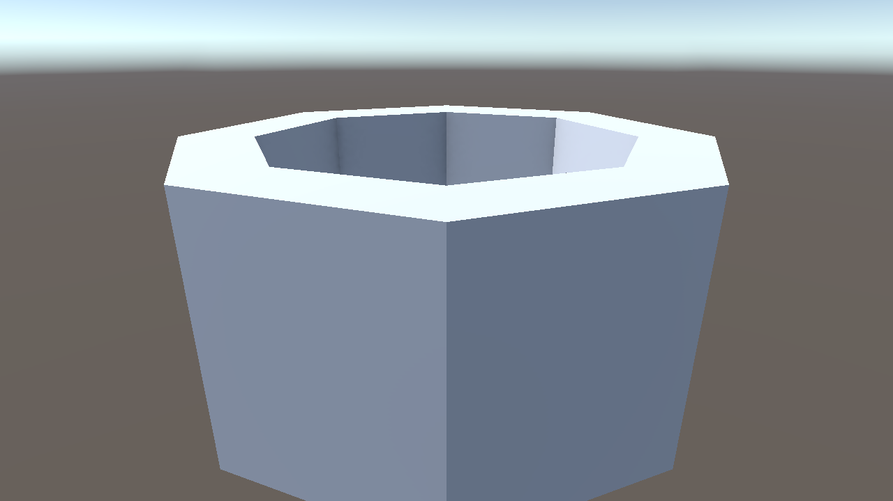

# ScenePilot 1.8.1 validation

The frozen RC20 package completed the software, independent-artifact and read-only web checks below. Earlier failures and original model versions remain recorded separately. These measured examples do not establish arbitrary-task reliability.

## Frozen candidate

- Unity **6000.3.27f1**.
- Package source: [`c265cea`](https://github.com/saslekawaiii/scenepilot-unity/commit/c265cea12ce47a5e79d8e2e28b24ba15fc2f0fdd).
- Candidate archive: `com.worldweaver.toolkit-1.8.1-rc20.tgz`.
- Prepared release archive: `com.worldweaver.toolkit-1.8.1.tgz`; byte-copy verification passed. Publication is a separate operation.
- SHA-256: `1730d51649e8aa70fd1d74e813ada4b00ab87522c05a5aad464a509d8d9acc2f`.
- Payload: **1880 files**. [Exact package manifest](package-manifest.json) and [versioned model/observer evidence](model-requests.json).

## Current-candidate software checks

| Suite | RC20 status |
| --- | --- |
| Editor | 965 total: 958 passed, 0 failed, 7 URP-only skips |
| Play Mode | 29 total: 27 passed, 0 failed, 2 external-provider skips |
| Python tooling | 16 passed, 0 failed; exact frozen archive |
| Runtime probe acceptance | 11 passed, 0 failed |
| Combined independent saved-artifact and URP suite | 44 passed, 0 failed, 0 skipped |
| Capture/checkpoint and light regressions in that suite | 7 capture/checkpoint and 5 light cases passed |
| Explanation/Plan and discovery-recovery regressions | 17 purpose and 12 recovery cases passed in the full Editor suite |

[Detailed software results and original hashes](software-tests.json) bind the completed suites to RC20. Its seven Editor skips require URP and passed in the separate actual URP suite. Its two Play skips remain the external cloud/local provider integration tests. Runtime acceptance includes six successful jobs and five expected failures or cancellation paths (failed assertion, missing assertion, timeout, exception and cancellation). Those five jobs correctly reported failure; they are not counted as successful gameplay jobs. All eleven acceptance cases confirmed their expected outcome and restoration checks. The 44-case suite consists of 3 game artifacts, 7 capture/checkpoint, 5 light, 17 purpose and 12 discovery-recovery cases; its overlapping rows must not be added again.

Earlier candidate counts are not RC20 results. RC19's independent suite passed **29/29**: 3 game artifacts + 7 capture/checkpoint + 5 light + 14 purpose cases. Its full Editor run was **950 total: 942 passed, 1 failed, 7 skipped**. That one test still expected an Ask question about creating trees to create a scene-count requirement; the test was corrected to preserve the exact informational question in provider input and the persisted request, without demanding authoring.

RC16's earlier full Editor run recorded **933 total: 920 passed, 6 failed, 7 skipped**. Those failures involved legacy ordering and geometry-format checks; they were software-suite failures, not six failed generated-game requests. They were addressed in RC17, whose focused URP suite passed **69/69** and Python tooling passed **16/16**. The earlier RC2 Editor run's 32 failures also remain recorded separately.

The new render/checkpoint tests exercise actual camera rendering, component identity, clean/dirty scene state and `CanExtend`. They also cover a Light in a prefab instance, existing URP settings, resource cleanup after a capture failure, and real manual Light/material edits that must still prevent continuation. URP-only cases require an actual URP pipeline; missing graphics or pipeline support is an explicit skip, never a pass.

## Real requests: original versions retained

The preregistered requests cover a hollow mesh, a keyboard-controlled hinged door and a pointer-driven counter whose state persists across Play restarts. Fresh runs use an empty scene and a new chat in an existing consumer. No ready implementation or solution plan is supplied.

| Result | Model run | Independent evidence and limits |
| --- | --- | --- |
| Hinged door | RC3 | The saved RC3 scene passed actual Space/L input, lock/state text, smooth rotation and physical passage checks, including the final RC19 repeat. This is not fresh RC19 model generation. |
| Persistent counter | RC3 | The corrected independent observer passed actual pointer clicks, bounds, reset and two genuine Play restarts, including the final RC19 repeat. Early observer setup failures are not game failures. |
| Hollow mesh | RC3 | Controller completion was rejected by the independent physical check: a ray reached the bottom instead of the required near top surface. |
| Hollow mesh | RC6, fresh run | Geometry, rays and dynamic-body support passed. Actual camera capture then exposed an incompatible built-in Standard shader under URP. A physics pass is not full visual acceptance. |
| Material-repair continuation | RC8, from the saved RC6 scene | The task failed after capture caused a false checkpoint conflict. It did not establish a successful material repair. |
| Material-repair continuation | RC10, from the RC8 saved partial repair of RC6 geometry | The real model completed controller checks and saved a clean scene: 12 implementation calls, 8 review calls, 21 tool steps. This is a continuation, not fresh RC19 generation, and it did not establish visual acceptance. |
| Saved-artifact checks | RC11 | The door, counter and mesh passed their programmatic checks. Actual mesh capture was still almost black: 116 of 128 stored vertex normals were zero. Visual acceptance therefore failed. |
| Visual-repair continuation | RC12, from the saved earlier repair | Failed after 16 implementation calls and 4 reviews. It diagnosed suspect normals, but recalculation left 116 zero normals. An invalid numeric overload and repeated reads followed; the host stopped without claiming success. |
| Same-request retry | RC13, continuation | Used exactly the RC12 request bytes, without a supplied normal-specific cause or ready repair. An accepted diagnostic stage contained 8 tool steps; the first apply of the replanned stage, at index 8, then hit the host progress boundary. The task stopped without completing the repair. This exposed a host accounting defect, not a demonstrated inability of the model to finish. |
| Planned web-reference request | RC15 | Never submitted to the model. The Editor stalled during synchronous startup scene loading before inference/report initialization; no model result exists. The completed RC16 request subsequently confirmed the deferred startup path worked for that run. |
| Web-reference request | RC16, fresh request | Independently passed: 3 model calls, 2 searches and 2 actual reads of official Unity pages. Both final links matched the opened URLs; all 249 observed project-file hashes and the scene digest were unchanged. The original false compilation badge is preserved separately from this content/integrity result. |
| Web-reference repeat | RC19, fresh request | Controller failed. An earlier failed search remained unresolved even after later successful official-page reads and the answer. This failed controller outcome is retained; it is not relabeled as success by a later host change. |
| Visual-repair continuation | RC17, completed | The model completed the repair after 16 implementation calls, 10 reviews and 31 tool steps, without a manual scene fix or supplied solution plan. Passive saved-asset readback found 288 vertices, 96 triangles, 288 unit normals, no zero-length normals and dimensions 3.5 × 1.6 × 3.5. Original inference attribution remains RC17. |
| Saved-artifact repeat | RC19 | All three saved artifacts passed. The mesh passed actual ring/aperture rays, dynamic support, stored-normal, material and camera checks; actual PNG pixels were also reviewed. Door and counter passed real input and Play behavior. All 260 original artifact-file hashes, including 38 scene files, remained unchanged. These RC19 records are preserved. |
| Final artifact checks | RC20 | Passed all three saved-artifact cases: actual mesh physics/rendering, door input/lock/passage and counter clicks/bounds/persistence. Rehashed all 260 original artifact files, including 38 scenes: no changed byte. Original mesh inference remains RC17 and door/counter inference remains RC3. |
| Web-reference repeat | RC20, fresh request | Controller and independent content/integrity checks passed after 3 model calls, 2 searches and 2 actual official-page reads. The second search's failed receipt was retained. All 287 observed project-file hashes and the scene digest were unchanged. One cited legacy URL resolves by a separately verified redirect to the opened official source; exact URL spelling is not claimed identical. |

The RC11 combined independent run was **13/14**: its remaining failure came from an additive-scene test fixture, not a generated game defect. That fixture is corrected separately. These counts are not a task-success rate, and the passing programmatic mesh test does not override the failed visual observation.

The RC18 combined run later passed 28/29, with all three game cases passing. Its sole failure was the Plan approval fixture's own untitled additive scene, which the existing checkpoint guard correctly rejected. RC19 stages only that fixture's temporary scene and keeps the guard plus the missing-player/compilation assertions intact; the complete combined repeat passed 29/29.

[Versioned case records](model-requests.json) keep controller and observer results separate. The observer sources are `scripts/HollowMeshArtifactAcceptanceTests.cs` and `scripts/NextAgentArtifactAcceptanceTests.cs`. Corrected input observers enter actual Play Mode, send virtual device events and observe game state; they do not call game handlers to stand in for user input. Input delivery telemetry is supporting evidence, not proof of the resulting mechanic.

## Visual evidence and checkpoint safety

Mesh acceptance includes actual PNG capture, material/shader support and the resolved quality/project render pipeline. It rejects known incompatibilities rather than treating every pink image as an error. Bounded samples of the actual top and inner-wall triangles check geometric camera visibility without imposing an artistic-quality score. Unknown custom shader/pipeline combinations remain unclassified.

For new Lights and changes to Light settings or transforms admitted by a task, required URP data is now initialized before the checkpoint is sealed. This addresses late initialization during ordinary Scene View rendering. The helper does not initialize untouched Lights or replace existing additional-light data. Read-only capture separately removes known URP data that its observation added to previously untouched Lights.

The general checkpoint conflict guard remains in place. RC20 passed actual rendering, clean-state, prefab-override and subsequent manual-edit regression checks. The [RC20 visual receipt](visual-review-rc20.json) binds its exact package archive, 44/44 independent XML result, artifact integrity and [actual RC20 capture](hollow-mesh-rc20.png). The image shows readable gray outer/inner walls and the bright top ring; the lowest outer edge is slightly cropped, so no full-frame or artistic-quality guarantee is claimed. The earlier [RC19 receipt](visual-review.json) and [RC19 capture](hollow-mesh-final.png) remain unchanged.

Stored vertex normals are now read independently of geometric face orientation. Bounded diagnostics report actual counts, non-finite and near-zero values, non-unit finite values and finite length ranges. Six new regression cases cover these facts and no-read limits. The warning is not an automatic repair instruction: unusual normals may be intentional for an unlit or custom shader. The real model must connect the measurements to the intended material and actual image.

## Recovery protocol consistency

RC12 exposed another host defect during recovery. In function-call mode, a rejected step could still receive instructions demanding EditorPlan JSON. In the opposite direction, a JSON fallback could retain instructions to make native calls after functions were disabled. The older tool results remained available; recovery instructions contradicted the active mode.

RC13 prepares a consistent contract for the actual active mode before sending and recording the request. It includes the current tool list, bounded error details and actual observations. Nine regressions cover the transitions. Existing validators, duplicate-read controls and manual-change protection are unchanged; these fixes do not by themselves demonstrate that the current visual repair succeeded.

## Diagnostic progress and structured failures

The RC13 retry exposed a separate stage-boundary bug. Its first diagnostic stage passed review after 8 tool steps, but the next stage reached the repeated-read budget on its first apply at index 8. The host now records an accepted new read-only diagnostic review as durable progress for that budget. Merely producing another plan, assigning another job ID, repeating a read or failing review does not reset it. This does not relabel diagnostic reads as scene implementation.

Fresh planning also retains bounded source windows around actual compiler errors, including line, column and the source hash. Diagnostic tests in RC14/RC15 then exposed a production serialization defect: rollback status text was prefixed to a JSON result, making it invalid JSON. This was not dismissed as a fixture problem. RC16 preserves the root JSON object and records rollback completion, error and scope separately before performing the existing rollback. Undo semantics are unchanged.

The focused RC16 suite passed all 11 actual URP diagnostic/rollback tests; RC17's broader focused run passed 69/69. RC20's full software, real-web and independent URP/game results are recorded separately above. These host fixes alone do not establish general task success.

## Read-only web evidence and task purpose

The [independent web-reference record](web-reference.json) retains the actual RC16 model and package identity. Two successful `web_read` results contain the same official URLs cited by the final answer. The original summaries did not expose numeric HTTP status, so later independent HTTP 200 responses and body hashes are labeled separately from the original returned-text hashes. The answer correctly distinguishes an allocating `OverlapSphere` result array from `OverlapSphereNonAlloc`'s bounded caller buffer and written count; a full buffer indicates possible truncation, not proof of additional hits. Only the written prefix is part of the current result. No Play Mode or physics execution was requested or claimed.

The same run exposed a task-status defect: its explicit prohibition against changing scripts was incorrectly interpreted as a compilation requirement. The actual answer and read-only integrity passed while the saved task contained a failed `required_compilation` check. That original badge is not erased or relabeled as a clean UI result.

RC18 added a persisted explanation purpose separate from mutation permission. Ask and explicit explanation requests do not acquire authoring criteria from mentions of code, players or object counts. An implementation plan still retains those criteria while waiting for approval and after approval. Legacy explicit explanations no longer demand a new compile event merely because of the old inferred flag; actual failed compilation evidence and explicit preservation checks remain failures. All fourteen regression cases passed on RC19, including persistence and real controller/approval paths. The historical RC16 result and original badge remain unchanged, and the failed RC19 controller repeat remains a separate result.

RC20 adds a general completion rule for explanatory research after optional discovery fails. It requires a complete nonempty answer, no failed explicit check, only read-only tools and a later accepted, wholly successful observation batch containing actual data. Replaying metadata or succeeding inside the original failed batch is insufficient. The historical failed steps are retained. Failed concrete reads, behavior jobs, compilation and mutations cannot be cleared by another read. All 12 recovery and 17 task-purpose cases passed in both the full Editor and final URP runs. The fresh RC20 model repeat finished with `explanation_complete`, no false compilation criterion and its earlier failed search still present. The rule contains no branch for a particular URL, search term or sample request.

The [independent RC20 web record](web-reference-rc20.json) preserves a URL nuance: the final reply used a legacy spelling for one source, while the tool opened its current official URL. Exact spelling differs. A later default-TLS HTTP request followed one redirect to that actual opened page, returned HTTP 200 and matched its content hash. This equivalence is not attributed to the original tool response. The original [RC16 record](web-reference.json) and failed [RC19 controller outcome](web-reference-rc19.json) remain separate historical evidence.

## Preserved failures and scope

The [1.8.0 RC23 mesh failure](../1.8.0/hollow-mesh.json) remains a failure. Later fixes do not rewrite it, the RC3 physical failure, the RC6 visual failure, the RC8 interrupted repair, the dark RC10 artifact observed on RC11, the failed RC12 repair, the RC13 task stopped by host accounting or the failed RC19 web controller run. The unsubmitted RC15 request remains an environment/harness startup failure. Earlier successful requests retain their original versions in the [1.8 report](../1.8.0/README.md).

These changes improve the agent host, tools and evidence handling; they do not change model weights or establish reliability on arbitrary tasks. Public exports omit provider internals, reasoning and private paths. The final RC20 integrity audit rehashed the original 260-file artifact manifest and found no changed file. It does not claim that every file outside that manifest was unchanged. RC19 integrity evidence remains immutable. Detailed records are retained locally and identified by hash.
